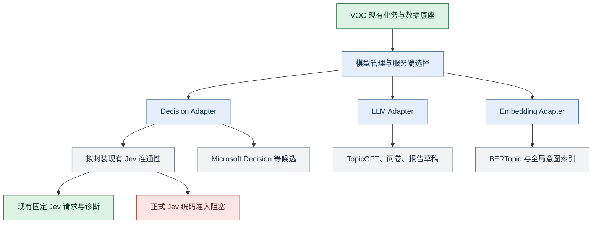

# 多模型适配器接口协议

`MODEL_ADAPTER_CONTRACT = PLANNED`。本文规定将来实现的对象、语义及验证边界。方法、字段是规划契约，具体 API、存储、同步或异步签名在所属阶段实施设计中核定。首个正式决策模型固定为 `jev-1.14.0`，真实准入取决于原 G-1、J 系列及 G4。[路线图](../planning/ROADMAP-V2.md) · [正式验收矩阵](../requirements-matrix.md)

## 接口树

绿色代表已存在的连通性实现，蓝色代表已规划的适配接口，灰色代表尚未接入的实现，红色代表正式编码当前受 G-1 阻塞。

通用治理层负责配置版本、审批、凭证引用、能力判定、预算、状态与运行追溯。服务端选择已获准的具体模型、供应商与通道，适配器只转换该类接口的类型化入参与返回。M06 仅消费内部合规回执、证据和版本。厂商返回原文由受控证据库保存。[M06 消费约束](m06-consumer-handover.md)

| 接口 | 请求与响应 | 计划执行边界 |
|---|---|---|
| Decision Adapter | 类型化 Choice、Score、Noul，返回每题实际结果、概率证据及用量 | 意图分类、未知拒绝、强度和问题判断、校准 |
| LLM Adapter | 带用途、已批准提示模板与版本、证据引用及输出 Schema；返回结构化草稿、证据映射、拒答/截断及用量 | TopicGPT、候选解释、问卷草稿和报告组织。人工审核接续，草稿不能充当正式决策回执 |
| Embedding Adapter | 批输入、预处理标识及语言；返回按输入对应的向量、有效维度、模型版和用量 | BERTopic、全局意图召回、相似度与主题比较。向量检索要绑定精确注册表和索引版本 |

未来候选包括 Microsoft Decision、后续 Jev 和其他决策模型，以及 GPT、Claude、Gemini、DeepSeek、Qwen、获准的本地或兼容生成模型。本地 BGE、Sentence Transformers 兼容模型、OpenAI Embedding 等为向量接入候选。用户提出的 `Microsoft-Decision-1.1` 按候选名称登记，具体 Model ID、端点、访问、价格、概率、用量和限制均待接入时核验。任何通道能力以实测和实际审批为准。

## 现有实现与接入职责

| 现有入口 | 已有能力 | 规划接入 |
|---|---|---|
| [config.py](../../src/config.py)、[Jev 请求](../../src/execution/jev.py) | `MODEL = "jev-1.14.0"`，Choice/Score/Noul、8 题分片、模型及字段核对、实际 `usage.input_tokens` 解析和分片记录 | M12-A 先保持原请求、校验和回执行为，再将编排与协议拆开。用 JevAdapter 和隔离合成适配器分测 |
| [传输](../../src/execution/transport.py)、[连通性检查](../../src/execution/checks.py) | 固定通道、外发标签、拒绝重定向、脱敏、故障分类和 G-1 | 适配器复用受控网关。正式供应商以真实验收取证 |
| [API 配置](../../src/dashboard/api_setup.py)、[工作区与额度](../../src/dashboard/app.py)、[凭证存储](../../src/raw_store/credentials.py) | 本机凭证、供应商审查、诊断和 Jev Token Center | 扩展配置与度量复用已有权限、凭证与账本。按实际单位投影 |
| [召回冒烟](../../src/discovery/recall.py)、[统计](../../src/raw_store/denominators.py) | C0-6 合成召回冒烟，C5 工程分母及合成回执 | M09 提供版本化向量；M12 接真实回执；M13 按冻结契约消费 |

架构分离先从 M09 向量、M10 最小生成接口及 M12 通用决策开始。第一版 M12 使用现行 Jev 路径进行真实验证并保留历史诊断与账本。隔离测试适配器只在合成域使用。真实判断、供应商协议扩展和通用模型管理界面各由所属工作单元验收。

## 模型注册与能力

Model Registry 以配置版追加记录。凭证仅用 `credential_ref` 引用 M02 安全存储。

| 配置组 | 规划字段 |
|---|---|
| 配置及运行身份 | `model_profile_id`、`configuration_version`、`model_type`、`provider_id`、`adapter_id`、`adapter_version`、`requested_model_id`、`approved_model_id`、`endpoint_profile_id`、`credential_ref` |
| 验证与授权 | `capability_profile_version`、`policy_approval_version`、适用的 `calibration_version` 及 `index_version`、`lifecycle_status`、`created_at`、`approved_at`、`updated_at` |
| 账本 | `usage_unit`、`pricing_version`。运行时另绑定实际账户及结算通道 |

能力表同时保存供应商声明、实测有效状态（`UNKNOWN`、`UNVERIFIED`、已证实支持、已证实不支持）、对应模型与通道版本、探针时间与证据引用。产品要求另按矩阵判断。

| 类别 | 需声明及验证的能力 |
|---|---|
| Decision | `supports_choice`、`supports_score`、`supports_noul`、`supports_choice_probabilities`、`supports_score_probabilities`、`supports_independent_noul`、`supports_exact_model_version`、`supports_usage_reporting`、`supports_documented_idempotency`、`supports_batch_requests`、`max_questions_per_request`、`max_choice_options`、Score 档位、输入与输出限制 |
| LLM | `supports_structured_output`、`supports_json_schema`、`context_limit`、`output_limit`、`usage_reporting`、`refusal_detection` |
| Embedding | `embedding_dimensions`、`supported_languages`、`normalization`、`distance_metric`、`max_input_length`、`supports_batch` |

向量与索引须绑定实际模型版、维度、语言、预处理版本、归一化、距离度量、索引和召回验收。更换模型后分开建索引和比对，旧索引保留自己的版本与输入。能力未知时相应路径保持不可用，按用途验证后再开放。

## DecisionRequest 内部请求

| 字段组 | 内容与约束 |
|---|---|
| 操作与版本 | `request_id`、`idempotency_key`、`study_id`、`mention_id`、`segment_revision`、`registry_version`、`index_version`、`question_set_version`、`model_profile_version`、`requested_model_id` |
| 证据及授权 | 当前可用的语义片段、获准上下文、实际 `evidence_id`、代表 `record_id` 和全部输入依赖，注明原帖、转载或上下文、冻结范围、原文摘要和区间。随任务记录资格、授权及策略版本 |
| 判断 | 稳定问题 ID、类型、说明、选项或档位语义。用显式 None 及另一个独立 Noul 判断是否属于现有意图。问题编号与分片计划可复现 |
| 限额 | 预算、运行与暂停约束、请求及响应大小、允许的用途和通道 |

适配器接收供应商所需的最小获准文本、问题定义与厂商路由字段。研究项目、内部证据及权限引用留在本机编排层，任何额外字段随独立审批核定。网络请求前重检该次实际输入，结果提交时在现有同连接事务内复核当前资格及 UTC，读、导出和出队分别重验。工程样本分域，真实研究请求不可从诊断回执提升资格。[冻结事务边界](m06-data-model.md#原子提交与并发)

## DecisionResponse 与回执

| 字段组 | 内容与校验 |
|---|---|
| 回执身份 | `request_id`、`response_id`、`provider_id`、`adapter_version`、`requested_model_id`、`actual_model_id`、`question_set_version`、分片标识、尝试编号及 `received_at` |
| `answer_results` | Choice 选项 ID 与完整选项概率；Score 数值与完整各档概率；Noul 独立实际概率和判定。按问题 ID、类型、上下文、合法选项和档位严格对齐 |
| 概率来源 | `probability_source` 标明供应商原始字段、按已批准契约显式派生或内部校准。原字段及可追溯的内部计算各自保留 |
| 用量和状态 | `provider_usage`、`billing_status`、`latency_ms`、`response_status`、`schema_validation_status`、受控 `raw_response_ref`，以及允许向调用方暴露的原因与脱敏 HTTP 状态 |

Jev 正式验证采用已有请求模型、上限和概率契约。每次最多 8 题，11 题实测为 8+3，Choice 2–20 个选项，Score 2–10 档。要求精确实际 model、完整问题集、稳定选项/档位和有限且在 [0,1] 的概率。Choice、Score 的完整分布按现有归一化规则检查。Noul 保存实际返回的每项 0–1 概率，守门单独执行。未来模型若协议已证实二元互补，可另记 (1-p) 的派生值并追踪转换依据。派生和校准字段不能替代 Jev 实际字段或填补缺失分布。

缺 Score 每档概率、Choice 概率不全或 Noul 缺字段归为 `schema_gap`。概率不靠自报置信度、默认值或修正来补齐。缺片、重复题、模型身份不符、候选或版本错误进入独立失败原因。仅完整且当前有效的同一次尝试可生成可消费回执，分片按相同版本与依赖合并。M06 按冻结规则判定统计与发布资格。

## 前置召回、适配操作和故障

从 M06 当前合格片段和实际上下文取得证据，固定 M07 注册表版本并从全局已确认意图召回。产品及任务可作可解释的软排序信号。最终最多 19 个已知意图加 None，再用独立 Noul 守门。候选为空、低相似、召回异常、Choice=None 或独立 Noul 拒绝时走待审或发现路径。绑定完整原始回执及校准结果后，M06 六桶统计由 M13 消费。模型切换保持 `mention_id`、`evidence_id` 和原话身份稳定。[J-14 与校准](model-evaluation-protocol.md)

| 适配器操作 | 责任 |
|---|---|
| `describe_capabilities`、`validate_configuration` | 报告配置版本、实测状态和服务约束，检查目标通道与批准模型身份 |
| `build_provider_request`、`execute` | 按能力构造最小类型化载荷，由批准的传输通道发送。预算、资格、审批和停止由编排执行 |
| `normalize_response`、`validate_response` | 保留原始响应证据，提取类型化结果并作完整性、权限范围和版本检查。LLM 单列拒绝或截断，向量逐项验维度及有限值 |
| `extract_usage`、`classify_error` | 留真实原生单位、来源和归因，向 UI 投影安全的错误及可否重试 |

| 错误类 | 业务动作 |
|---|---|
| 配置缺失、审批或输入失格、模型不一致 | 停止并记录安全错误码，按实际类别修复后重新运行 |
| `schema_gap`、错误载荷、拒绝或截断 | 保留受控响应与失败位置。放行条件按对应契约评估 |
| 401、402、403、429、5xx 或断网超时 | 区分凭证、余额、权限、限流及上游/网络。402 暂停新批次，已完成记录可查。明确未知扣费时先对账 |
| 幂等冲突或不确定提交 | 同键限于同载荷、同模型、同通道与获准依赖。复核后读取原结果或进入对账。供应商安全重放必须有文档及实测，缺依据时保持暂停 |

## 数据安全及模型配置中心

M02 的后续 API & AI Model Center 可按 Decision、LLM、Embedding 管理服务商、Model ID、已审 Base URL、凭证引用、连接和能力诊断、真实模型版本、审核、用量/额度/价格、项目级默认、停用及轮换。服务端登记并验证端点，外部 HTTPS 使用通道白名单及 SSRF 防护，检查解析结果、私有和本机地址并拒绝任意重定向。本地推理使用专门批准的本机通道。密钥只送对应的受审服务，禁止跨服务商、日志、浏览器、导出或仓库曝光。

内部 CX、公司非公开数据及问卷原始答卷留在授权本机。外部通道仅接收授权且脱敏的公开内容。来源许可、当前资格、组织与账户授权、实际服务商及中转商的留存、地区及分处理商分别核验。变更通道须复审。来源撤回、用途撤权或到期后停止相关消费、重验历史回执。第三方页面、原话和模型响应均当作不可信数据，响应只能经过声明的结构和权限检查，不能取得工具调用权限。

## 用量、预算与既有账本

按通道、供应商、账户、模型/配置版本、运行、题组/注册表、尝试、分片及时间追溯。记录真实的 input/output/embedding tokens、请求数、credits、缓存用量或其他原生计费单位。预算、预留、已确认扣费和不确定扣费分态。费用区分实际账单与估算值，保留币种、价格版本和时间。按单位汇总，未知余额显示未同步，并注明最近同步及来源。Jev 继续按实际 `usage.input_tokens`、可实证的 `X-Tokens-Remaining`、分片防重及原 TC/J/G 条目核对。[生命周期与运行模式](model-lifecycle-and-calibration.md) · [扩展需求编号](../requirements-matrix.md#roadmap-v2-规划扩展映射)
