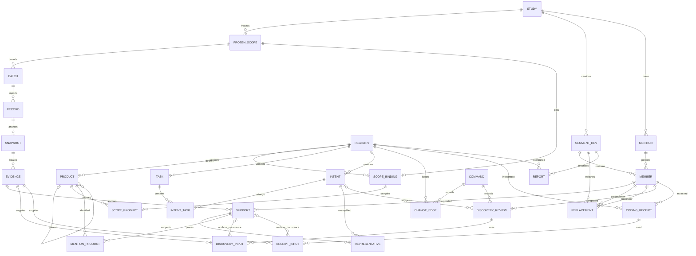

# M06 数据模型与事务

这是基于 SQLite v6 的增量设计草案。表名用于评审数据约束，字段尚未落库。M06 拥有身份、关系和约束；M07 经营注册表，M11 操作审核，M12 提供编码回执，M13 持有报告。完整身份与切片示例见[总体设计](m06-design.md)，计数见[统计契约](m06-statistics-contract.md)。

## 实体关系

STUDY、FROZEN_SCOPE、BATCH、RECORD、SNAPSHOT 对应 v6 的 study_projects、study_scope_freezes、import_batches、import_rows、corpus_snapshots。FK 到 v6 只用于定位。任何读取原文、取数、写关系或出报告均走 M05 资格服务。图中最后三种下游对象（编码回执、其输入、报告）是消费者接口，本次升级不预建它们。

## 字段与约束约定

以下记法给出关系所需的全部设计列。T=SQLite TEXT，I=INTEGER，J=TEXT 且 json_valid，? 为可空。时间为 UTC RFC 3339，日历日为 ISO 日期。所有标识、枚举、哈希均为 T；布尔 I 限 0/1。记作 S、V、R、M、E、P、C、A 的地方分别展开为 study_id、registry_version、segment_revision、mention_id、evidence_id、product_category_id、category_id、intent_id。主键列全部显式 NOT NULL。复合 FK 使用完全相同的列序及排序规则，父键声明 PRIMARY KEY 或 UNIQUE；约束默认 RESTRICT。全文和来源链接只保存在现有受控来源。

无 `?` 字段均显式 `NOT NULL`。可空复合外键只用于关系确实可缺席的分支，以 CHECK 限定是否可空，明确测试 SQLite 对含 NULL 的复合外键及 CHECK 的行为。每条连接开启 `foreign_keys=ON`，迁移及封版测试运行 `foreign_key_check`。命令和实际版本的项目归属一致，按项目引用时用 `(S,command_id)` 外键，不以 ID 字符串或命名空间推断归属。

### 全局定义与冻结绑定

| 表 | 字段及键 | 约束与读模型 |
|---|---|---|
| registry | V:T PK，parent_version:T? FK→registry，created_at:T，command_id:T FK→command，sealed:I | 唯一非空 parent_version，`UNIQUE INDEX ON registry((1)) WHERE parent_version IS NULL` 防多根。父版必须已封版并先存在，禁止自指和同事务链式环。V 使用可解析语义版本，HTTP 不按字符串 MAX 解析 HEAD。每一版原子写入完整定义及边，候选变化也留版。 |
| product | V:T，P:T，name:T，description:T，parent_id:T?，status:T，version:T，PK(V,P) | FK V→registry，(V,parent_id)→product。candidate/confirmed/merged/retired。锁内查递归祖先，禁止自指及环。名称可改，ID 永不重用。适用产品、服务，多级可选。 |
| task | V:T，C:T，name:T，definition:T，inclusion_criteria:T，exclusion_criteria:T，discovery:T，lifecycle_status:T，version:T，PK(V,C)，UQ(V,C,lifecycle_status) | FK V→registry。discovery 为 preset/discovered，含获准共享的正反边界。candidate/confirmed/rejected/merged/retired。发现批次、首次项目使用及私有审核信息保存在项目受控记录。 |
| intent | V:T，A:T，name:T，definition:T，inclusion_criteria:T，exclusion_criteria:T，lifecycle_status:T，primary_category_id:T?，primary_marker:I，survey_validation_status:T，version:T，PK(V,A) | FK V→registry。candidate/pending_parent/confirmed/rejected/merged/retired。CHECK 约束 confirmed 必须有主任务，primary_marker 固定 1。延迟复合 FK (V,A,primary_category_id,primary_marker)→intent_task(V,A,C,is_primary)。共享问卷状态来自获准发布的版本，具体项目问卷依据留在项目受控记录。 |
| intent_task | V:T，A:T，C:T，is_primary:I，task_status:T，PK(V,A,C)，UQ(V,A,C,is_primary) | (V,A)→intent，(V,C,task_status)→task(V,C,lifecycle_status)，CHECK task_status='confirmed'。唯一部分索引 (V,A) WHERE is_primary=1。候选建议放在受控审核记录。反向索引(V,C,A)。正式边的通用业务定义可经单独审核共享，项目证据和自由文本审核理由留在项目内。 |
| representative | V:T，A:T，S:T，R:I，M:T，E:T，PK(V,A,S,R,M,E) | (V,A)→intent，(S,R,M,E)→support。封版前锁内由有权操作者确认至少三次独立发生及每条原话/链接，按 M 与发生核定；同一 M 的多个 E、跨项目重复选入同一发生都不能凑数。跨项目无法区分独立发生时不得满足门槛。当前资格损失仅在有权的消费路径计算，避免在全局路由暴露跨项目的支持数量、来源或撤销原因。 |
| scope_binding | S:T，scope_id:T，V:T，mapping_status:T，command_id:T，PK(S,scope_id)，UQ(S,scope_id,V) | (S,scope_id)→study_scope_freezes 的现有 v6 复合父键，V→registry，(S,command_id)→command。仅创建已审核的 `mapped_product` 或 `non_product` 绑定，未解析为独立审计状态 `unresolved`。实际 scope_version 来自同一 study_scopes.version_no。 |
| scope_product | S:T，scope_id:T，V:T，P:T，PK(S,scope_id,P) | (S,scope_id,V)→scope_binding，(V,P)→product。封版触发校验 mapped_product 至少一条 confirmed 品类、non_product 零条。范围用作抽样约束，证据边需逐条取证。 |

三种全局稳定 ID 使用各自命名空间，含义相同可沿用，已拒绝/合并/停用 ID 保留墓碑，后继以 change_edge 记录。定义微调升实体次版本，结构变动（合并、拆分等）升主版本；发行版本与单条实体版本分列。已发布研究的冻结范围仍引用某节点时，拒绝停用；先经授权完成范围替代与活动引用退出，历史冻结继续解析不可覆盖的原版及祖先链。旧 content_json 保留原样。含无法核实的品类字符串时，登记 unresolved 与项目审核事件，阻止依赖品类的正式发布。历史映射经人工核定精确稳定 ID 与版本后建立绑定，不以名称自动匹配；无产品研究须有明确的 non_product 审核映射。范围品类与编码注册表版本可以不同，按稳定 ID 跟踪并同时返回两个版本。

### 项目片段与证据

| 表 | 字段及键 | 约束与索引 |
|---|---|---|
| evidence | S:T，E:T，record_id:T，scope_id:T，raw_sha256:T，start_cp:I，end_cp:I，PK(S,E)，UQ(S,record_id,raw_sha256,start_cp,end_cp) | (S,scope_id)→freeze；在 v6 snapshot 上补 UQ(study_id,record_id,scope_id,raw_sha256) 供同序四列 FK。核查原文摘要、0≤start_cp<end_cp≤原文码点数。批次、来源及原文时间取同一条 M05 trace/metadata。额外索引 (S,scope_id,record_id)。 |
| mention | S:T，M:T，created_at:T，PK(S,M) | S→study_projects。本机 UUID 在事务中首次分配，不含用户身份、文本或可变的组主键。优先以已核准来源区间查回现有 M，跨来源同一发生由人工或可靠原帖锚点证明。 |
| segment_rev | S:T，R:I，parent_rev:I?，rule_version:T，created_at:T，command_id:T，sealed:I，PK(S,R)，UQ(S,R,parent_rev) | S→study_projects，(S,parent_rev)→segment_rev，(S,command_id)→command。每 S 单根部分唯一索引及唯一非空父版，CHECK parent_rev<R。父版已封版，读请求固定已封版 R，并发写校验 expected_revision。 |
| member | S:T，R:I，M:T，identity_state:T，PK(S,R,M) | (S,R)→segment_rev，(S,M)→mention。identity_state=distinct/needs_review。待确认为同一次发生的输入在排除台账保留，核清前不重复入合格集合。旧 R 固定，新 R 复用未变的 ID。 |
| support | S:T，R:I，M:T，E:T，segment_no:I，occurrence_basis:T，review_ref:T，PK(S,R,M,E)，UQ(S,R,E) | (S,R,M)→member，(S,E)→evidence。segment_no 为规则版内原始行的段序，重切可变化。同一版同一原始区间只支持一个发生；不同需求应切为可区别的区间；无法区分先待审。新成员至少一条区间证据，当前能否使用逐次判定。加索引 (S,E,R)。 |
| mention_product | S:T，R:I，M:T，E:T，catalog_version:T，P:T，link_type:T，review_status:T，command_id:T，PK(S,R,M,E,P) | (S,R,M,E)→support，(catalog_version,P)→product，(S,command_id)→command。P 必须能回到当前该条原话。review_status=auto/queued/human_confirmed。P0 建议仅 human_confirmed 可生效；auto 仅作可追溯提议，正式自动确认待负责人裁定，见[决策](m06-decisions.md)。索引(S,P,R,M)。 |
| replacement | S:T，R:I，old_rev:I，old_mention_id:T，new_mention_id:T，reason:T，PK(S,R,old_mention_id,new_mention_id) | (S,R,old_rev)→segment_rev(S,R,parent_rev)，(S,old_rev,old_mention_id)→member，(S,R,new_mention_id)→member。拆并使用不同 M，封版验证稳定 ID 有向环。调整坐标且语义和发生不变时沿用 M，保留两版 support。 |
| discovery_review | S:T，R:I，M:T，V:T，seq:I，A:T?，review_state:T，reason_code:T，command_id:T，PK(S,R,M,V,seq) | (S,R,M)→member，V→registry，非空(V,A)→intent，(S,command_id)→command。M09/M10 提出，M11 决定；open/accepted/rejected/closed 与原因分列。当前只读取该键最新决定，若其依赖失格则标待复核，不回退至旧决定，不由此获得编码发布资格。 |
| discovery_input | S:T，R:I，M:T，V:T，seq:I，E:T，dependency_role:T，target_e:T?，PK(S,R,M,V,seq,E,dependency_role) | 精确绑定 discovery_review；(S,E)→evidence，(S,R,M,target_e)→support。occurrence 与 context 使用下文 receipt_input 相同的互斥 CHECK，使无独立 M 的合法上下文也可登记。所有实际使用的区间重核 M05 资格；失格触发待复核。 |

成员与边采用每个已提交版次的完整集合，借用原有证据锚点，不复制原文。重复导入若已有同一 record_id 和区间则命中唯一键；新批次给新 record_id 时另存 E，再核原出处以决定是否复用 M。未确定的转载先隔离有转载线索的新输入，已经独立核准且无争议的原发生可继续计一次；整个身份均有争议时挂起全部涉疑成员。索引可从 M 查其全部 E，亦可从变动的原始行查到受影响的 M。M05 返回的 duplicate.group_id 与 duplicate.canonical_record_id 是当次提示，不作 FK。

### 审计及消费接口

| 表或消费对象 | 字段及键 | 保留策略 |
|---|---|---|
| command | command_id:T PK，S:T?，namespace:T，operation:T，idempotency_key:T，input_hash:T，actor_ref:T，reason:T，created_at:T，result_ref:J，UQ(namespace,operation,idempotency_key)，UQ(S,command_id) | S→study_projects，可空仅限纯全局定义命令。联合命令保留来源项目授权绑定；项目命令命名空间由服务端生成。哈希覆盖规范化输入、预期版本及服务端确认的作用域。结果仅含 ID/版本，重放仍核操作者和项目权限；失败回滚，与审核驳回记录分开。自由文本及 S 不进入共享定义投影。 |
| change_edge | V:T，seq:I，command_id:T，kind:T，from_version:T?，from_id:T?，to_id:T?，action:T，PK(V,seq) | V/from_version→registry，command_id→command。CHECK 约束可空端及动作；封版触发器按 kind 校验对应实体和版本，排除跨类型及引用不存在。可用分类型表和精确 FK 实现等价约束。全局只投影获准共享的类型及定义变更，不透出私有命令。 |
| coding_receipt（M12 逻辑接口） | receipt_id:T PK，S:T，R:I，M:T，V:T，attempt_no:I，supersedes:T?，A:T?，index_version:T，question_set_version:T，model_id:T，input_hash:T，candidate_list:J，shard_refs:J，assessment:J，publication_status:T，created_at:T，UQ(S,R,M,V,attempt_no)，UQ(receipt_id,S,R,M,V) | (S,R,M)→member，V→registry，非空(V,A)→intent，(supersedes,S,R,M,V)→receipt，前序 attempt_no 必须更低。每个绑定仅一个有效发布决定，受控指针原子切换，不因最新尝试草稿或失格回退旧回执。完整性与校准归 M12。 |
| receipt_input（M12 逻辑接口） | receipt_id:T，S:T，R:I，M:T，V:T，E:T，dependency_role:T，target_e:T?，PK(receipt_id,E,dependency_role) | (receipt_id,S,R,M,V)→receipt，(S,E)→evidence，(S,R,M,target_e)→support。CHECK 限定 occurrence 时 target_e 非空且等于 E，context 时 target_e 为空。封版核至少一个 occurrence。context 可来自另一片段，也可只有合格来源区间而未产生独立 M。登记每条实际输入并按 (S,E) 反查；任一必要输入失格即停用回执，需重新分析和审核。 |
| report（M13 引用契约） | report_id:T PK，S:T，R:I，scope_versions:J，V:T，index_version:T，filters:J，computed_at:T，receipt_refs:J，counts:J，supersedes:T? | 绑定项目、片段版与注册表，scope_versions 枚举实际冻结范围，保存 UTC 窗口、来源/批次、算法/阈值及证据引用。归档记录只追加，当前可展示性另查。原文、许可附件和用户身份不进入此载荷。 |

未分段的排除事件、URL/页面数沿用 M04/M05 或后续 M08 已有可授权的输入台账；按[计数单位](m06-statistics-contract.md)投影，无可核稳定输入键的阶段返回不可用。六桶属于派生视图，不建可随意编辑的 bucket 列。无需创建“产品×意图”事实总表，正反两个方向共享 support → mention_product 和有效编码回执。

报告实际依赖须能回推至同一 S/R/V 的全部回执、必要 evidence、scope、授权判定日期及相应版本。M13 可用约束过的依赖清单实现，JSON 快照只供历史记录和还原筛选。失去当前资格时按受限元数据访问规则处理旧报告，并以重新计算、复核和发新版本恢复内容。

## 原子提交与并发

1. 可信审核入口校验操作者与项目权限，解析请求，按固定版本的规范化规则生成载荷摘要。无需外部请求即可取得判定依据后，使用同一个 Store 连接 `BEGIN IMMEDIATE`。查同命令键，在当前操作者和作用域仍获准时以相同摘要返回原提交的受控引用。相同键不同摘要拒绝，幂等查找先于 expected version 比较。
2. 在锁内比较封版 HEAD 与预期 V/R、核项目写权限、冻结引用和输入资格。现有 M05 公开方法自开读事务。在获准实施时于 `src/raw_store/corpus.py` 增加内部方法 `qualified_record_in_transaction(db, study_id, record_id, *, today)`，使用原有 `source_row`、`qualification`、`describe` 及允许字段投影；由公开方法和 M06 同连接写入分别调用。沿用 `Store.connect()` 注册的来源、许可和遮蔽逻辑，保留 GET 404/409、现有响应字段与 false 研究/外发标志。不要用历史 verified、暂存原文、缓存的外部 GET 或另一 SQLite 文件的只读连接替代。已验证的 WAL 交错见 [M06-B SQLite 探针](../evidence/m06-b/sqlite-results.md)。
3. 写入未封版提案、完整成员及其边、命令结果和受影响关系。以部分唯一索引、复合 FK 和 CHECK 实施声明约束。对成员至少一个 support、代表性独立发生数、冻结品类状态、封版父版本、指针和候选主边一致、产品及替代索引无环、变更端点及活动引用保护，在封版触发器或同等数据库约束下校验。全局及项目 HEAD 只指向已封版行；数据库禁止对已封版的版本、成员和关联增删改。封版事务外不可读取中间状态。
4. 所有本次资格查询使用同一 UTC 日期。提交前比较最新 UTC 日期，跨日则回滚重算，最终 COMMIT 错误须显式 rollback 并恢复干净事务状态。并发胜者发行；等待方重取写锁后，陈旧预期版返回 409，持久写忙按有限退避后给可重试错误。完整提交后客户端断开，由同键重放返回原引用。确认的共享定义与项目编码发布走各自状态流。
5. 资格与项目权限随使用时刻变化。短读使用同一快照及 UTC 日；长统计出结果前在新快照复核实际依赖的版本、权限、M05 资格与日期。有变化则废弃结果并重算。首版避免跨请求缓存原文、资格与未复核聚合；旧报告再展示、下载和出队前复核全部必要依赖。数据库写锁只能约束同库写者，对自然到期、提交后撤销、验证与送达间的时差以及已分发内容不作原子保证。

已发布版本作为历史定义继续存在。某条代表原话失格后，在获准项目读路径实时遮蔽，并为有权复核者生成依赖整改记录。建议具有相关权限的服务确认代表性门槛或实际编码依赖失效后，暂停受影响的正式产出或重新核算，交 M07/M11 审核新定义或替代支持。单一读者缺乏项目权限只限制其投影；跨项目判定及历史输出访问策略待[负责人裁定](m06-decisions.md)。共享定义视图不公开可反推出他人撤销事件的状态，获准审计者可读脱敏历史元数据。新授权使 M05 当前行有可能重新合格，不能自动恢复旧编码、旧统计或旧报告。

## v6 升级与恢复预案

建议下一次获准实施时把上述 M06 表、父键唯一索引与读取接口作为一个 v6→下一版的增量，消费对象随下游模块实施。沿用 Store 的外键、WAL 和迁移事务。离线备份使用 SQLite 一致性备份，校验 user_version、外键及 integrity_check；不要只复制正在写入的主库文件。先在 v6 副本验证冻结/跨项目键，再建父索引、空关系表及索引，外键与完整性检查通过后最后更新版本号并提交。检测未知高版本继续拒绝；M01 的 fixture/diagnostic 路径沿用其限定升级策略。

升级时不给历史行自动生成 mention、许可、已发布状态或品类匹配。无 M06 绑定的历史范围和旧报告仍能经旧入口定位。归档的项目只读，受限证据继续遮蔽。对象定义、变更理由与引用可保留；当前原文/敏感缓存遵守留存与撤销，最小化审计字段，不复制 CX 或实词摘录。失败时回滚并核 v6 原记录数、ID、范围及版本号；进程中断后先校验数据库再重试。已提交升级后若需回退，以停写、备份新写入、恢复升级前一致性备份和核查写入差额为步骤；不执行删表降级。空库、v6、有旧许可记录、存在未解析范围、磁盘写失败与重复启动均列入后续工程验收。
