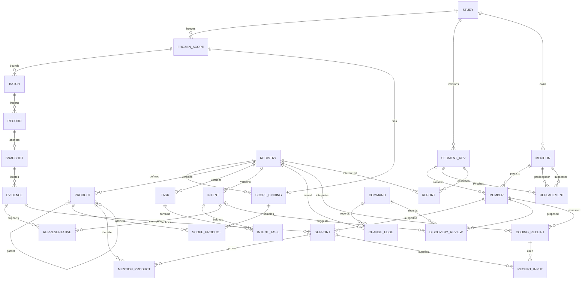

# M06-A 数据模型与事务

这是基于 SQLite v6 的增量设计草案。表名用于评审数据约束，字段尚未落库。M06 拥有身份、关系和约束；M07 经营注册表，M11 操作审核，M12 提供编码回执，M13 持有报告。完整身份与切片示例见[总体设计](m06-design.md)，计数见[统计契约](m06-statistics-contract.md)。

## 实体关系

STUDY、FROZEN_SCOPE、BATCH、RECORD、SNAPSHOT 对应 v6 的 study_projects、study_scope_freezes、import_batches、import_rows、corpus_snapshots。FK 到 v6 只用于定位。任何读取原文、取数、写关系或出报告均走 M05 资格服务。图中最后三种下游对象（编码回执、其输入、报告）是消费者接口，本次升级不预建它们。

## 字段与约束约定

以下记法给出关系所需的全部设计列。T=SQLite TEXT，I=INTEGER，J=TEXT 且 json_valid，? 为可空。时间为 UTC RFC 3339，日历日为 ISO 日期。所有标识、枚举、哈希均为 T；布尔 I 限 0/1。记作 S、V、R、M、E、P、C、A 的地方分别展开为 study_id、registry_version、segment_revision、mention_id、evidence_id、product_category_id、category_id、intent_id。主键列全部显式 NOT NULL。复合 FK 使用完全相同的列序及排序规则，父键声明 PRIMARY KEY 或 UNIQUE；约束默认 RESTRICT。全文和来源链接只保存在现有受控来源。

### 全局定义与冻结绑定

| 表 | 字段及键 | 约束与读模型 |
|---|---|---|
| registry | V:T PK，parent_version:T? FK→registry，created_at:T，command_id:T FK→command | 单一全局谱系。唯一非空 parent_version 加单一根约束。V 使用可解析语义版本，先比较父指针再发行。每一版原子写入可解析的完整定义及边，候选变化也留版。 |
| product | V:T，P:T，name:T，description:T，parent_id:T?，status:T，version:T，PK(V,P) | FK V→registry，(V,parent_id)→product。candidate/confirmed/merged/retired。锁内查递归祖先，禁止自指及环。名称可改，ID 永不重用。适用产品、服务，多级可选。 |
| task | V:T，C:T，name:T，definition:T，inclusion_criteria:T，exclusion_criteria:T，discovery:T，discovery_batch:T?，first_used_at:T，lifecycle_status:T，version:T，PK(V,C) | FK V→registry。discovery 为 preset/discovered，含正反边界。candidate/confirmed/rejected/merged/retired。主次角色随某个意图的关系而定。 |
| intent | V:T，A:T，name:T，definition:T，inclusion_criteria:T，exclusion_criteria:T，first_discovered_at:T，discovery_batch:T?，lifecycle_status:T，survey_validation_status:T，version:T，PK(V,A) | FK V→registry。candidate/pending_parent/confirmed/rejected/merged/retired；问卷状态 unvalidated/validating/validated/failed。失败触发人工降级、拆分或退候选并记原因。 |
| intent_task | V:T，A:T，C:T，is_primary:I，reason:T，evidence_ref:T?，PK(V,A,C) | (V,A)→intent，(V,C)→task。唯一部分索引 (V,A) WHERE is_primary=1。确认时还需跨表验证恰有一条主边，主边指向 confirmed 任务，所有正式边指向该版有效成员。反向索引(V,C,A)。 |
| representative | V:T，A:T，S:T，E:T，PK(V,A,S,E) | (V,A)→intent，(S,E)→evidence。引用独立审过的代表原话，项目授权过滤后动态组装 Schema 的原文/链接及分来源 n。确认时至少三条独立可核的代表原话及链接；重复转载不能凑足三条。失格触发再审并遮蔽，受限项目不能导出别的项目的原文或 n。 |
| scope_binding | S:T，scope_id:T，V:T，command_id:T FK→command，PK(S,scope_id)，UQ(S,scope_id,V) | (S,scope_id)→study_scope_freezes，V→registry。保存当时用于核定范围品类的版本。实际 scope_version 从同一 study_scopes.version_no 生成并与请求比对；不得从最新范围补取。 |
| scope_product | S:T，scope_id:T，V:T，P:T，PK(S,scope_id,P) | (S,scope_id,V)→scope_binding，(V,P)→product。每个冻结范围允许 0..n 条；非产品课题以绑定存在且集合为空表达。范围只是抽样约束，不能自动生成产品证据边。 |

三种全局稳定 ID 使用各自命名空间，含义相同可沿用，已拒绝/合并/停用 ID 保留墓碑，后继以 change_edge 记录。定义微调升实体次版本，结构变动（合并、拆分等）升主版本；发行版本与单条实体版本分列。发布范围时验证其列表全部为 confirmed；试图停用正在被已发布范围引用的节点须拒绝，或先走经授权的范围替代与项目退役流程。历史冻结继续解析原版，历史实体与祖先链不可覆盖。旧 content_json 中未能核实的字符串保留原样，显式标为 unresolved，阻止依赖品类的正式发布，人工登记精确映射后再建 binding。范围品类与编码注册表版本可以不同，用同一稳定 ID 跟踪，呈现时同时返回两个版本。

### 项目片段与证据

| 表 | 字段及键 | 约束与索引 |
|---|---|---|
| evidence | S:T，E:T，record_id:T，scope_id:T，raw_sha256:T，start_cp:I，end_cp:I，PK(S,E)，UQ(S,record_id,raw_sha256,start_cp,end_cp) | (S,scope_id)→freeze；在 v6 snapshot 上补 UQ(study_id,record_id,scope_id,raw_sha256) 供四列 FK。核查原文摘要、0≤start_cp<end_cp≤原文码点数。批次、来源及原文时间取同一条 M05 trace/metadata。额外索引 (S,scope_id,record_id)。 |
| mention | S:T，M:T，created_at:T，PK(S,M) | S→study_projects。本机 UUID 在事务中首次分配，不含用户身份、文本或可变的组主键。优先以已核准来源区间查回现有 M，跨来源同一发生由人工或可靠原帖锚点证明。 |
| segment_rev | S:T，R:I，parent_rev:I?，rule_version:T，created_at:T，command_id:T FK→command，PK(S,R) | S→study_projects，(S,parent_rev)→segment_rev。单根、每父仅一后继、R 单调递增。一个项目一个当前完整成员集（最新已提交 R），读请求固定 R；并发写校验 expected_revision。 |
| member | S:T，R:I，M:T，identity_state:T，PK(S,R,M) | (S,R)→segment_rev，(S,M)→mention。identity_state=distinct/needs_review。待确认为同一次发生的输入在排除台账保留，核清前不重复入合格集合。旧 R 固定，新 R 复用未变的 ID。 |
| support | S:T，R:I，M:T，E:T，segment_no:I，occurrence_basis:T，review_ref:T，PK(S,R,M,E)，UQ(S,R,E) | (S,R,M)→member，(S,E)→evidence。segment_no 为规则版内原始行的段序，重切可变化。同一版同一原始区间只支持一个发生；不同需求应切为可区别的区间；无法区分先待审。新成员至少一条区间证据，当前能否使用逐次判定。加索引 (S,E,R)。 |
| mention_product | S:T，R:I，M:T，E:T，catalog_version:T，P:T，link_type:T，review_status:T，PK(S,R,M,E,P) | (S,R,M,E)→support，(catalog_version,P)→product，P 必须能回到当前该条原话。review_status=auto/queued/human_confirmed。本案推荐正式产品边须 human_confirmed，auto 只作带标识的待核线索，待 M06-B 审定。索引(S,P,R,M)。 |
| replacement | S:T，R:I，old_mention_id:T，new_mention_id:T，reason:T，PK(S,R,old_mention_id,new_mention_id) | (S,R)→segment_rev，新旧各有 (S,id)→mention。旧 M 属于父版，新 M 属于本版；拆并跨版、非自指，检查无环。调整坐标但语义及发生不变可复用 M，保留两版 support。 |
| discovery_review | S:T，R:I，M:T，V:T，seq:I，A:T?，review_state:T，reason_code:T，command_id:T FK→command，PK(S,R,M,V,seq) | (S,R,M)→member，V→registry，非空(V,A)→intent。按项目和版本追加候选关联/人审引用；open/accepted/rejected/closed 与原因分列，以最高 seq 的有效决定解释未编码阶段的缺父、低相似或待审。M09/M10 提出，M11 决定。不会产生编码发布资格。 |

成员与边采用每个已提交版次的完整集合，借用原有证据锚点，不复制原文。重复导入若已有同一 record_id 和区间则命中唯一键；新批次给新 record_id 时另存 E，再核原出处以决定是否复用 M。未确定的转载先隔离可疑新输入，已经独立核准且无争议的原发生可继续计一次；整个身份均有争议时挂起全部涉疑成员。索引可从 M 查其全部 E，亦可从变动的原始行查到受影响的 M。duplicate.group_id 与 primary_record_id 作为 M05 当次提示返回，不作 FK。

### 审计及消费接口

| 表或消费对象 | 字段及键 | 保留策略 |
|---|---|---|
| command | command_id:T PK，namespace:T，operation:T，idempotency_key:T，input_hash:T，actor_ref:T，reason:T，created_at:T，result_ref:J，UQ(namespace,operation,idempotency_key) | 命名空间为 global 或 study/S。哈希覆盖标准化的全部输入及预期版次。和变更同一事务写入。结果仅含 ID/版本，重放时重新核授权；失败回滚，审核驳回作为独立已提交事件。 |
| change_edge | V:T，seq:I，command_id:T，kind:T，from_version:T?，from_id:T?，to_id:T?，action:T，PK(V,seq) | V/from_version→registry，command_id→command。kind 决定 product/task/intent，据 kind 查对应版本实体的存在性（多态引用在写事务校验）。创建/拒绝可单端，拆并追加多行。支持按实体和版本追溯。 |
| coding_receipt（M12 逻辑接口） | receipt_id:T PK，S:T，R:I，M:T，V:T，attempt_no:I，supersedes:T?，A:T?，index_version:T，question_set_version:T，model_id:T，input_hash:T，candidate_list:J，shard_refs:J，assessment:J，publication_status:T，created_at:T，UQ(S,R,M,V,attempt_no) | (S,R,M)→member，V→registry，非空(V,A)→intent，supersedes→receipt。每次取绑定视图下唯一有效的审核/发布决定，禁止把多次尝试拼成完整响应。assessment 含分片、schema、Choice/Noul、阈值/审核版本与理由。publication_status 取 queued/published/withdrawn 等明示状态；评分、分片与校准细节归 M12。 |
| receipt_input（M12 逻辑接口） | receipt_id:T，S:T，R:I，M:T，E:T，PK(receipt_id,E) | 同时精确绑定同一 receipt 的成员键与 support 全键，存编码实际依赖的各证据，便于撤销时逐一核输入。 |
| report（M13 引用契约） | report_id:T PK，S:T，R:I，scope_versions:J，V:T，index_version:T，filters:J，computed_at:T，receipt_refs:J，counts:J，supersedes:T? | 绑定项目、片段版与注册表，scope_versions 枚举实际冻结范围，保存 UTC 窗口、来源/批次、算法/阈值及证据引用。归档记录只追加，当前可展示性另查。原文、许可附件和用户身份不进入此载荷。 |

未分段的排除事件、URL/页面数沿用 M04/M05 或后续 M08 已有可授权的输入台账；按[计数单位](m06-statistics-contract.md)投影，无可核稳定输入键的阶段返回不可用。六桶属于派生视图，不建可随意编辑的 bucket 列。无需创建“产品×意图”事实总表，正反两个方向共享 support → mention_product 和有效编码回执。

## 原子提交与并发

1. M11 传入两候选 ID、预期注册表版、任务归属/理由、可核代表证据、操作者及幂等键。先查权限；取 SQLite 写锁 BEGIN IMMEDIATE，查旧命令，同载荷已成功返回原版引用，不同载荷拒绝。
2. 比较当前全局 HEAD 与预期版；若同时切片则也比较项目 R。锁内确认引用、冻结保护、许可、无环、边界与证据数。M05 公共方法现自开只读事务，建议下轮将同一资格判定提取为可接收当前连接的内部入口，公共方法与 GET 都继续委托它。工程实现前须用双连接验证只读/写入竞态与 UTC 到期。调用独立 GET 后隔一段时间再写不能提供该保证。
3. 在新 V 中确认候选任务、确认意图、附主次及证据、写 change_edge；验证全版已确认意图主边数量恰为 1，关联任务有效、已确认意图的代表原话满足门槛。拒绝/拆并/停用还须扫描所有入向活动引用，有依赖就连同重挂方案一起审议。缺主者保持 candidate/pending_parent；不得已确认后补写。SQLite 的部分唯一索引只防“两主”，发布检查补足“至少一主”。
4. 同一事务完成最终 UTC 留存期复检、版本发布、命令结果及受影响引用登记。任何校验/写入失败整笔回滚。资格依然在下一次读时复核。并发胜者发行，过期写者取得 409 后重读；数据库忙按有限退避重试原命令。断连后以同一幂等键恢复，绝不再造一次发行。注册表确认自此可被下游采用，片段的编码/发布需要独立回执。
5. 实时读在同一短读事务内解析 R、V、活跃证据并记判定时刻；对长统计分批计算后验证相关版次、资格变化和 UTC 日期，过期便丢弃结果并重算。首版优先无跨请求原文及资格缓存；已发报告再展示或导出前必须执行当前复核。

## v6 升级与恢复预案

建议下一次获准实施时把上述 M06 表、父键唯一索引与读取接口作为一个 v6→下一版的增量，消费对象随下游模块实施。沿用 Store 的外键、WAL 和迁移事务。离线备份使用 SQLite 一致性备份，校验 user_version、外键及 integrity_check；不要只复制正在写入的主库文件。先在 v6 副本验证冻结/跨项目键，再建父索引、空关系表及索引，外键与完整性检查通过后最后更新版本号并提交。检测未知高版本继续拒绝；M01 的 fixture/diagnostic 路径沿用其限定升级策略。

升级时不给历史行自动生成 mention、许可、已发布状态或品类匹配。无 M06 绑定的历史范围和旧报告仍能经旧入口定位。归档的项目只读，受限证据继续遮蔽。对象定义、变更理由与引用可保留；当前原文/敏感缓存遵守留存与撤销，最小化审计字段，不复制 CX 或实词摘录。失败时回滚并核 v6 原记录数、ID、范围及版本号；进程中断后先校验数据库再重试。已提交升级后若需回退，以停写、备份新写入、恢复升级前一致性备份和核查写入差额为步骤；不执行删表降级。空库、v6、有旧许可记录、存在未解析范围、磁盘写失败与重复启动均列入后续工程验收。
