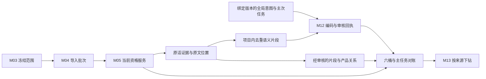

# M06 三层用户需求关系设计

**M06-B-F 架构冻结。** 审核输入为 `2651d66c6f14f93b05e8123f4ca8009eaede37a4`。五项政策已经负责人批准，M06 实现 NOT_STARTED。Windows 10 既有实测基线为 `4e6369b92205c51671866935365678df351ec808`。Windows 11 实机 NOT_TESTED，Pre-M06 Gate、G-1 均 BLOCKED。[冻结依据](m06-owner-approval.md) · [实机证据](../evidence/pre-m06/windows10-closeout.md)

研究者要回答两个不同的问题。“哪些任务使用了这个意图”查询绑定版本的分类定义。“哪些产品出现了这个意图”按项目、冻结范围和合法片段证据反查。例如营养秤与空气炸锅用户都可表达“断网继续操作”；去掉炸锅一侧唯一合法证据后，炸锅关联应消失，任务定义和营养秤侧证据仍可使用。

## 设计依据与兼容面

| 来源 | 已有内容及本轮处理 |
|---|---|
| [PDT Word 正文](../pdt/PDT-v1.3.1.docx)、[仓库摘要](../pdt/PDT-v1.3.1.md)、[需求矩阵](../requirements-matrix.md) | 已读 Word 正文及表格，文件 SHA-256 为 `09edf47c95151276b39c4b375cd1e7e1f805591fb8d65b8f2c512087283a11b7`。§6 定义三层、唯一主归属和 CAT；§7.2.1 与 §7.5 约束召回与分片；§8 规定候选、盲测和变更；§9.3 规定分母与可回查字段；§13.0 的六项 C0 优先于旧五项列表。 |
| [专案摘要](../proposal/voc-workbench-proposal-2026-11-23.md) | 27 页 v2.2 PDF 未收录。摘要不能证明原件的 §5A 逐句内容。审议用 §6 三层和登记的冲突口径；原件专属措辞、历史提案页码留待补核。 |
| [六层与路线图](../../MODULE_ROADMAP.md)、[规范](../../AGENTS.md)、[项目入口](../../README.md)、[开发状态](../../DEVELOPMENT_STATUS.md)、[交接](../../HANDOVER.md) | 沿采集、原始、发现、执行、仪表盘、输出六层放置数据接口。本轮授权设计覆盖冻结文档中“等 M06-A 授权”的历史状态。 |
| [SQLite 迁移 001–006](../../src/raw_store/migrations)、[研究范围](../../src/raw_store/studies.py)、[导入](../../src/raw_store/imports.py) | 001 连通性回执与分片；002 项目与不可变范围及冻结；003 文件、工作表行、批次与撤销；004 原话快照和审核；005 结构化许可和受限暂存；006 重评历史撤销。M01 的整数 evidence 主键只属于诊断/运行回执。 |
| [原始库](../../src/raw_store/corpus.py)、[当前资格](../../src/raw_store/corpus_access.py)、[测试](../../tests/test_pre_m06_audit.py)、[审计](../audits/pre-m06-audit.md)、[缺陷](../audits/bug-register.md) | 已有 UTC 到期、同源撤销、旧库、合成/内部隔离、跨项目与范围版本回归。M05 的长文本精确组采用 NFC 与空白归一；短文本需外部标识和来源。同组只是检查转载的线索；资格输出含冻结范围、行、来源、原文指纹。 |
| [现有 Schema](../../schemas)、[现有召回](../../src/discovery/recall.py)、[执行](../../src/execution/jev.py)、[工作台](../../src/dashboard/app.py) | 保留产品、任务、注册表、范围、片段产品边、桶和逻辑宽表的字段含义。采样日志由 M08 提供，问卷映射交 M14。旧意图 Schema 强制主类与代表原话，仅适配已确认实体，候选使用单独读模型；受限或不足的原话禁止拼凑成完整导出。宽表的 verified 为购买标记。 |

## 身份、语义与证据

1. **原始行**。复用 M05 的 record_id 和 raw_sha256。仅从工程合格的完整原文切片。先按段落保留段序，再按可独立编码的目的分段。“要离线称重，也想导出一周记录”生成两个 mention；同一目的的理由或同义重复保留上下文。歧义待人工，绝不以关键词数生成需求数。坐标采用原字符串 Unicode 码点的半开区间，不对原文做 NFC、换行替换或修剪后再计位；浏览器按码点转换 UTF-16 显示。界面只显示获准前后文。编码需逐段登记实际使用的需求区间和上下文；上下文可以只有证据锚点，不另生成一次需求发生。
2. **独立证据**。evidence_id 指向一条 M05 记录及其原文区间，原文和 URL 通过该记录的实时资格服务取回。相同记录、摘要、坐标复用一个证据；不同原始来源保有不同证据。语义规则版本、当前主记录、桶、意图、品类都不进入证据 ID。文件改名、重复确认先由 M04 幂等命中，若独立批次生成新行则保存新证据并判定是否同一发生。
3. **去重片段**。mention_id 是项目内一次具体需求表达的稳定标识。仅在原出处及原帖/评论与段位一致，或有可审核的转载链证明同一发生时合并。相同表述来自两个可区别的真实发言则保留两条；相似度、匿名作者、M05 重复组、同意图均不足以自动合并。疑似转载暂挂身份复核，不双计；无法建立人数时只解释为片段数。一个源行可支持多个片段，跨来源证据可支持同一个片段。每次读某条产品边还须验证支持该产品的那条证据。
4. **重试与重新切分**。随机分配的 UUID 与唯一来源区间、项目内幂等命令键在同一事务中绑定。重试先查原区间及活动映射；相同的需求及边界经核对可跨规则版本复用 mention_id。一个旧片段拆成两个独立需求则分配两个新 ID，记录一对多替代边；合并同一发生的两个旧片段形成新 ID 和多对一边。只修偏移且含义不变时可保留 mention_id、另建证据。并行产出先在本地内存提出，锁内复核后成批切换一个项目版次。历史分析仍指向当时版次。M05 换主仅改变显示顺序。
5. **缺失与撤销**。每次展示、编码准备、分类索引、分母、回放及输出都重检证据。部分撤销仅移去相应的证据、品类及来源切片；保留部分必须足以独立支持同一语义及所展示断言。编码如依赖已失格文本、上下文或输入摘要，则挂起重验/重编码。全撤销只保留授权审计用引用，当前分母剔除；新授权后重新校验并重新走发布条件。即使旧版回放也不能显示当前受限原文。

## M06-B 对表达身份的裁定

| 观察到的关系 | 可支持的判断 | 对发生数的影响 |
|---|---|---|
| 原文逐字相同 | 是文本匹配线索。两位用户分别写“希望能离线”时保留两份独立出处。 | 两次可定位的独立发言计 2。 |
| 语义相似 | 发现模块可提出相同候选意图。 | 不能据相似度合并发生。 |
| 同一次需求表达 | 平台命名空间内的原始事件/评论 ID 可核且同一目的区间及上下文对应；或有可复核的显式转载链回到同一原始事件，逐段确认引用边界和目的。 | 同一项目内复用一个 M，各来源保留独立 E。带转载的新评论先区分转引段和本人新增表达。 |
| 同一个真实用户 | 本项目无需识别自然人。即便用户相同，另一个时间或渠道可再次独立表达。 | 依据每次发生及目的计数，禁止按用户或账号归并，禁止从片段数反推人数。 |
| 同一用户意图 | 多条独立表达可映射到同一版本的意图；一条原话也可能有多个独立目的。 | 分别在发生和编码层决定，归到同一意图仍可计多次。 |

仅有同文、近义、相近时间、匿名或同一账号时，按可独立定位的原始发言切片。有正面转载信号（如明确自称转引）但出处断裂、上下文或段位冲突时，提交有项目访问权的人工复核，锁定涉疑输入；独立可证的原帖继续计一次。保留证据引用、依据类型、复核人、决定和版次。无证可定的作者不开展跨渠道身份追踪。复核后追加版本，旧报告按旧身份版本回放并重检访问权。

按可合法使用的来源、品类及适用的语言、批次列出已评估、待核、无法分层的候选输入及待核率（待核输入数 / 同层已评估输入数，分母为零时为 null）。以同一抽样框重算两个假设边界（待核分别全为可并入的副本、全为独立发生；没有已知原发生时以证据支持的最少发生数为下界），列出对切片趋势的影响。边界只作偏差诊断。待核率高的渠道应单独解释；样本许可不足以诊断时显示覆盖缺项。身份主账和正式发布资格保持独立。 mention 数不能直接解释为独立用户人数或总体市场需求占比。

## 定义共享与历史范围

发布全局定义时只投影允许共享的定义字段，审查名称、释义、理由、例句中的可识别文字。项目 ID、证据定位、来源计数、私有链接、变更意见或许可附件保留在项目内受控读模型；把两项目的定义版本绑定到同一个 V 不会扩大访问权。仅可见一条原话的用户，不能借隐藏条数差、反查或导出推知另一项目。授权审核者复核后区分“代表原话已失格”和“当前读者无权看”。前者触发受影响版本消费重核，后者只限制当前投影。历史版本不就地重写；降级、替换与恢复须有可追踪决定。

M03 的 scope 冻结只证明范围及其版次已固定。“已发布研究”须有受控发布依据。新发布前验证引用的同版产品与祖先链有效，停用/迁移前检查在用的已发布研究和其依赖链，封存旧目录快照。旧范围未核清、经确认的非产品范围、已完整筛选且命中零条须分别呈现为 unresolved、显式空品类绑定、可用的 0。范围中有某产品也不能替代对应原话。 旧范围映射按项目、冻结范围及独立 mapping_revision 追加，目录节点由有权审核者按精确目录版核验。历史报告固定映射版；替代需发行新映射、查发布引用与历史影响。

## 六层模块交接

| 消费者 | M06 提供 | 下游责任 |
|---|---|---|
| M07 注册表 | 稳定三类 ID、不可变版本、主次约束、合并/拆分映射 | 维护定义、代表原话与证据构成、版本发行和全局授权；共用版本不授予项目间查看证据的权限。 |
| M08 采集 | 冻结范围、证据坐标、来源批次键及排除口径 | 建合法采样日志和来源计数，逐源确认许可，向 M05 交接后再读资格。 |
| M09 BERTopic | 合格 mention 与匿名引用、范围和版本 | 本机主题簇、证据和残差候选，不写正式归属。 |
| M10 TopicGPT | 同一批次和版本的允许输入、发现队列 ID | 四步发现、候选及差异；外部处理须独立许可，内部 CX 始终本机。 |
| M11 人审 | 验证接口、联合确认原子命令和回执 | 候选联审、否决/合并、低置信复核、操作者授权和理由。 |
| M12 Jev | 绑定版次、独立 mention、证据和全局有效意图集合 | 实际召回、独立 Noul、固定模型完整三类概率、校准、逐分片及发布回执。 |
| M13 看板 | 同一筛选的六桶、主类对账、来源/原话下钻和失效状态 | 正式图表、分组样本门槛、报告发布前重新核对。 |
| M14 问卷 | 证据引用、问卷验证状态及对应定义版本 | 审批与真人回流、题目映射；原始答卷限本机，验证结果与编码审核分别记账。 |
| M15 Radar | 指定范围、版本和窗口的可重算切片 | 竞品对比、历史报告与偏差解释，不直接相加跨来源口径。 |

[批准记录](m06-owner-approval.md)给出冻结判定与材料缺口，[实施计划](m06-implementation-plan.md)列出 C1–C5 的文件范围、依赖与验收断言。正式统计另需 G-1、逐源准入和 M12 实证。
