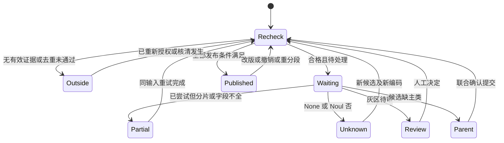

# M06 分母与状态对账契约

依据 PDT §6.6、§9.3 与 [counting_bucket Schema](../../schemas/counting_bucket.schema.json)。以下规则定义将来的计算。在 G-1、项目及逐源正式准入、M12 的真实编码与校准证据未齐时，正式接口返回 availability=unavailable、counts=null 和缺项；不把未测解释成零。工程界面另报可核的工程证据；演练必须标为 synthetic，禁止与正式数字合并。

## 分母链与计数单位

| 链上值 | 计数单位和来源 | 可比边界 |
|---|---|---|
| N_discovered_urls | M08 采样日志中本筛选发现的独立 URL，保留原始键与规范化依据 | 导入任务不适用时为 null 并注明原因。 |
| N_accessible_pages | 可访问且有采集回执的独立页面键，重试一次仍是一页 | UTC 窗口与来源须可追溯。 |
| N_extracted_mentions | 规则版下抽取的原始表达发生候选数，同原文独立目的分别列项，尚未跨来源去重 | 页与片段单位不同，后数可大于前数。 |
| N_eligible_dedup | 在同一项目和选定版次，符合本模式许可、原话角色、隐私、冻结范围、去重身份及筛选的 distinct mention_id 数 | 进入六桶集合；有多个适配证据仍只有一行。 |
| N_published_classified | 上一集合中命中已发布已归类条件的 COUNT(DISTINCT mention_id) | 正式主类占比的唯一分母。分母为 0 时比例 null，实际可核的计数为 0。 |

**排除账**以同一抽取版的已知候选输入计数，键为项目、原始行、摘要、区间及该抽取版的候选标识。一个输入键只记一个主因，顺序为无许可/撤销或到期、无可核证据、身份待核、重复发生，次因可多值。未能合法切片的整行按 record_id 计为 excluded_unsegmented_records，单列单位与原因。已切片的失格输入使用保留且获准计数的最小定位引用，受限原话始终遮蔽。同一次发生在本切片内从仍合格的匹配输入选一条稳定代表，其他匹配输入归重复排除，其合法证据依然独立可查。若来源 A/B 各有该发生的一条输入，A、B 各自的重复排除为 0，两源并集的重复排除为 1。代表随切片确定，M05 重复组主记录的切换不改变 mention_id。

N_excluded 只统计可证明落入本切片的已知排除输入。筛选维度若因遮蔽、缺失或从未验证而不能确定归属，应标记该阶段覆盖不全并返回 null 或单列明确标注的可核数。禁止将这些记录补成“归属无”或读受限文本来分类。先有抽取台账、同版同筛选且每个候选输入完整映射到唯一资格/排除结果时，可以另核候选账内的守恒。PDT 分母链本身跨越 URL、页面、抽取输入和唯一发生等不同单位，禁止用其相邻步骤差替代 N_excluded。若查询意图、任务、置信度等只在较后步骤产生的属性，较早步骤缺对应属性时返回 null，或明示较宽的独立切片范围。

身份待核针对表达发生及出处的归并。独立来源对象可核的匿名原帖按自身发生保留。身份暂挂可能使转载多、原帖链接易失效或匿名比例高的来源系统性低计。M13 应在有合法可用的来源、产品或范围分层中报告已知身份待核输入数、已评估输入数和覆盖缺项，并保留复核后的分母变动。待核输入保持排除，比例变化仍须注明采样局限。统计单位是可核的表达发生，不推断真实用户人数。 待核率以同层待核输入 / 同层已评估输入计算，分母为零时为 null。必要时列争议输入不同处置下的敏感性范围，另列正式分母；样本构成与许可偏差限制外推，mention 数不能直接解释为市场需求占比。

## 判定顺序

冻结口径标识为 `counting_policy_version=M06-B-F.1`，覆盖下表次序、单位、排除优先级与筛选规则。在统计响应、游标、发布回执语境及历史报告固定该版本。变更前须报负责人另批，保留新旧规则、同一可用切片的差额、差异原因和不可比较项；历史报告不能静默换版。单个已知尝试缺分片可归 partial_or_schema_gap，整批缺真实编码或必要数据时，正式接口返回 unavailable/null。

先筛集合，再解析该片段与片段版、注册表版、所选索引及题组口径下唯一生效的编码决定与审核事件。旧回执保留为审计引用。新尝试启动时可以保留现行决定，只有经明确提交的替换、撤回、输入失效才改变其生效状态。禁止从可用尝试中取任意旧的 published 状态来补位或拼接不同尝试的分片。多个竞争决定属于一致性故障，应中止正式对账并记录；一个决定合法缺席时可以按候选事件或待处理状态归桶。

对当前决定的所有实际输入逐项复核，包括原话区间、跨句上下文及实际送入编码的其他合格证据。固定题组、模型、索引、输入摘要、校准和人工决定所依赖的版本。任一输入失格，整条依赖它的决定退出分桶依据，即使另一条证据仍可证明同一发生。最新独立且仍有效的发现或审核事件可继续解释状态。已撤回的发布决定须保留可追溯的有效状态。重新授权后只有经显式复验重放或重编以及独立发布检查，才可再次进入发布桶。随后按表顺序命中一个桶，次要异常可保留原因码。

| 次序 | 命中条件 | 唯一结果 | 可进入主类分母 |
|---|---|---|---|
| 0 | 失格、表达发生身份待核、非本项目、筛选条件没有同一条证据满足，或候选输入是本切片同一发生的额外副本 | 前两类与重复输入按排除账。查询不匹配仅在切片外，跨项目不可见。额外副本不移除该发生的合格代表 | 否 |
| 1 | 实际尝试编码缺关键分片、失败未合并、类型/概率校验失败，含 Score 只有单值 | partial_or_schema_gap，记录失败分片/字段 | 否 |
| 2 | 旧决定依赖已失格的输入，且没有基于仍合格证据的当前回执或发现审核决定 | other_pending，等待重新核验或编码。旧决定的字段缺失、None 或低置信均已经退出依据 | 否 |
| 3 | 完整有效回执中 Choice=None 或独立 Noul 明确拒绝 | none_unknown；送发现池，保存两道判断 | 否 |
| 4 | 已有可核的低置信、守门灰区、分类边界不清等未决人审事项 | review_pending。候选同时缺父时附加该原因，当前见解已关闭后重算 | 否 |
| 5 | 有经记录的候选意图关联，但该版无唯一有效主任务大类 | pending_parent；允许在编码前由发现审核提供候选关联；有实际失败分片仍遵循第 1 行 | 否 |
| 6 | 完整且可复核的同版 M12 三类回执、Choice 非 None、独立守门通过、有效唯一已确认意图及同版有效主类、满足校准的 auto 或 human_confirmed，publication_status=published，全部输入仍合格 | published_classified，按主类计 1，次类只下钻 | 是 |
| 7 | 其余已合格者，例如等待发布、意图已退回、换版须重编码、已撤回编码发布决定 | other_pending | 否 |

未启动编码且无发现审核事件、召回异常或无候选均在第 7 行；有当前 discovery_review 的低相似待审或无父候选分别命中第 4、5 行。发现确认意图不自动发布片段。生命周期、问卷验证结果、当前来源资格、编码 publication_status、所选注册表版本与本次读出的 counting_bucket 各自保留。第 6 行的 auto 专指 M12 经校准的意图编码，P0 产品关系须人工确认。一次人工决定不能补造缺失的提供商概率。

状态图画的是触发重新判定的事件；Recheck 执行完整优先级表；Outside 在六桶之外。任何桶收到来源变化都回到 Recheck。对 withdrawn、到期、归档、重新授权分别按 M05 判定；隔离批次撤销后其他证据须按 M05 的同源及同文件行副本限制再次检查，不能仅凭“另有一行”保留。

## 筛选与复核算法

1. 固定 study_id、segment_revision、registry_version、资格判定 UTC 时刻及 mode；精确目录 V、mapping_revision、counting_policy_version 随结果返回。scope_id 与 scope_version 成对匹配 M03 冻结记录。历史报告同时固定 index_version、窗口与当时输入。跨项目共用 V 只能复用定义，各项目分别计。
2. 每条 support 经 qualified_record 复核 trace、摘要与区间。先在**同一证据**上取 scope、batch_id、source、时间和有依据的产品关系交集，再对 mention_id 做存在性半连接。产品多选默认并集，明确所选集合。时间默认原话 published_at 的 UTC 半开区间 [from,to)；缺时间不参加带窗结果，另报缺项。采集窗口需显式选择 collected_at，不自动回退。产品、来源等过滤条件缺值不算命中。
3. 对得出的每个 M 检查编码实际使用的证据和输入摘要是否仍有效。多个证据合法时，仍应能支持这次所显示的断言。某产品失去最后一条证据只移除该产品边；若编码输入失效则重验回执。更换 R/V 不能直接继承旧回执，须有明确重验证明或重编。若统计指定回执 index_version，则仅使用该索引版对应决定，返回同版覆盖情况。
4. 证据过滤完成、唯一回执及状态解析后，由统一结果集处理意图、任务或置信度谓词，再求全部桶和主类数。过滤值不可判定的片段不匹配该谓词，若需查看未归属项则显式选这一状态。按次类浏览仅计算该关系下的 distinct M，标记为“关联片段”。该切片的正式对账仍按每个片段真正的主类归档。来源、批次或产品的小计重叠时重新求并集。
5. 两条硬对账为 N_eligible_dedup = 六桶之和，Σ主类 published distinct M = N_published_classified。返回每桶数、N_excluded 与分原因、缺失阶段及相同 filter_echo。任何差额阻止报告发布并附可核的项目内原因引用。审计计数可回看原版本和旧结论形成依据；当前用户可见的证据及数字须复核撤销、留存期、来源和现行访问权。已失效的报告标记失效，保留旧版受控审计引用，另发重算版，不显示失格原文。中途到期或数据变化丢弃过期计算。

手算样例及混合异常见[原设计反例](m06-test-plan.md)和[独立反例](../evidence/m06-b/counterexamples.md)。M06 定义单位、接口、优先级与断言。M08 提供采集链，M07/M11 负责发行与审批，M12 提供真实回执和校准，M13 用同口径发布。优先级与排除账已列入[负责人批准记录](m06-owner-approval.md)，现有正式验收依据仍为 PDT。
