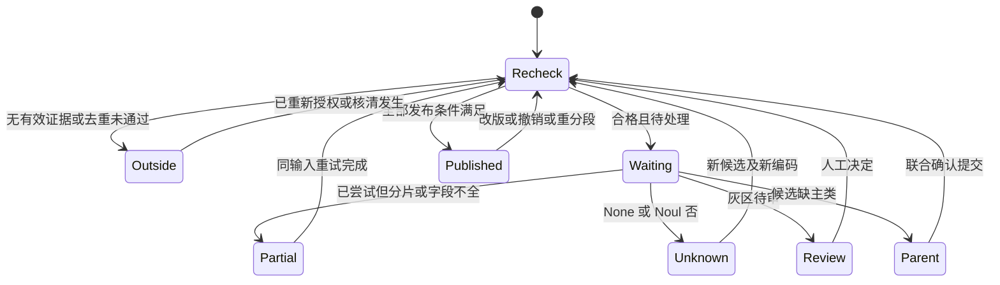

# M06-A 分母与状态对账契约

依据 PDT §6.6、§9.3 与 [counting_bucket Schema](../../schemas/counting_bucket.schema.json)。以下规则定义将来的计算。在 G-1、项目及逐源正式准入、M12 的真实编码与校准证据未齐时，正式接口返回 availability=unavailable、counts=null 和缺项；不把未测解释成零。工程界面另报可核的工程证据；演练必须标为 synthetic，禁止与正式数字合并。

## 分母链与计数单位

| 链上值 | 计数单位和来源 | 可比边界 |
|---|---|---|
| N_discovered_urls | M08 采样日志中本筛选发现的独立 URL，保留原始键与规范化依据 | 导入任务不适用时为 null 并注明原因。 |
| N_accessible_pages | 可访问且有采集回执的独立页面键，重试一次仍是一页 | UTC 窗口与来源须可追溯。 |
| N_extracted_mentions | 规则版下抽取的原始表达发生候选数，同原文独立目的分别列项，尚未跨来源去重 | 页与片段单位不同，后数可大于前数。 |
| N_eligible_dedup | 在同一项目和选定版次，符合本模式许可、原话角色、隐私、冻结范围、去重身份及筛选的 distinct mention_id 数 | 进入六桶集合；有多个适配证据仍只有一行。 |
| N_published_classified | 上一集合中命中已发布已归类条件的 COUNT(DISTINCT mention_id) | 正式主类占比的唯一分母。分母为 0 时比例 null，实际可核的计数为 0。 |

**排除账**按候选发生（输入区间）计，一个稳定键记一次主因。已分段的键为项目、原始行、摘要、区间和本次抽取版；未能合法读取/切片的整行只按 record_id 记为未切分输入，单列单位及件数，不能臆测其中有几个需求。N_excluded 在已知候选发生上统计，另报 excluded_unsegmented_records，缺少输入台账返回 null。无许可/撤销或到期优先于无可核证据，其次是身份待核、重复发生。附加原因可多值，主因互斥。纳入一个规范发生时，以稳定的合格输入键确定一条计数代表；同一发生的额外抽取输入记 duplicate，多来源证据仍保留。全部撤销时原先纳入的发生移出，并按当前可知输入键归入排除账，禁止重新切受限原文以补数字。N_excluded 既不加进六桶，也不能直接与 URL 数、未切分行数或 distinct mention 数相减。

## 判定顺序

先筛集合，并剔除当前输入已经失效的旧决定。对每个合格 M 选择该 R/V 下唯一当前有效回执及其审核决定。按表从上往下首个命中者归桶。保留原因清单以解释次要异常；桶值只返回一个。PDT 规定先源资格、再完整性、再归属；同层异常的优先顺序是本设计提案。

| 次序 | 命中条件 | 唯一结果 | 可进入主类分母 |
|---|---|---|---|
| 0 | 失格、身份不明、未胜出的重复输入、非本项目，或筛选条件没有同一条证据满足 | 失格/重复按排除账；不匹配查询仅在切片外；跨项目不可见 | 否 |
| 1 | 实际尝试编码缺关键分片、失败未合并、类型/概率校验失败，含 Score 只有单值 | partial_or_schema_gap，记录失败分片/字段 | 否 |
| 2 | 旧决定依赖已失格的输入，且没有基于仍合格证据的当前回执或发现审核决定 | other_pending，等待重新核验或编码 | 否 |
| 3 | 完整有效回执中 Choice=None 或独立 Noul 明确拒绝 | none_unknown；送发现池，保存两道判断 | 否 |
| 4 | 已有可核的低置信、守门灰区、边界不清等未决人审事项 | review_pending；即使候选缺父也保留该缺父原因 | 否 |
| 5 | 有经记录的候选意图关联，但该版无唯一有效主任务大类 | pending_parent；允许在编码前由发现审核提供候选关联；有实际失败分片仍遵循第 1 行 | 否 |
| 6 | 完整且可复核的 M12 三类回执、独立守门通过、有效唯一已确认意图及主类、满足校准的 auto 或 human_confirmed，publication_status=published，输入未失效 | published_classified，按主类计 1，次类只下钻 | 是 |
| 7 | 其余已合格者，例如等待发布、意图已退回、换版须重编码、已撤回编码发布决定 | other_pending | 否 |

未启动编码且无发现审核事件、召回异常或无候选均在第 7 行；有当前 discovery_review 的低相似待审或无父候选分别命中第 4、5 行。发现确认意图不自动发布片段。生命周期、问卷验证结果、当前来源资格、编码 publication_status、所选注册表版本与本次读出的 counting_bucket 各自保留。一次人工决定不能补造缺失的提供商概率。

状态图画的是触发重新判定的事件；Recheck 执行完整优先级表；Outside 在六桶之外。任何桶收到来源变化都回到 Recheck。对 withdrawn、到期、归档、重新授权分别按 M05 判定；隔离批次撤销后其他证据须按 M05 的同源及同文件行副本限制再次检查，不能仅凭“另有一行”保留。

## 筛选与复核算法

1. 固定 study_id、segment_revision、registry_version、资格判定 UTC 时刻及 mode；scope_id 与 scope_version 成对匹配 M03 冻结记录。历史报告同时固定 index_version、窗口与当时输入。跨项目共用 V 只能复用定义，各项目分别计。
2. 每条 support 经 qualified_record 复核 trace、摘要与区间。先在**同一证据**上取 scope、batch_id、source、时间和有依据的产品关系交集，再对 mention_id 做存在性半连接。产品多选默认并集，明确所选集合。时间默认原话 published_at 的 UTC 半开区间 [from,to)；缺时间不参加带窗结果，另报缺项。采集窗口需显式选择 collected_at，不自动回退。产品、来源等过滤条件缺值不算命中。
3. 对得出的每个 M 检查编码实际使用的证据和输入摘要是否仍有效。多个证据合法时，仍应能支持这次所显示的断言。某产品失去最后一条证据只移除该产品边；若编码输入失效则重验回执。更换 R/V 不能直接继承旧回执，须有明确重验证明或重编。若统计指定回执 index_version，则仅使用该索引版对应决定，返回同版覆盖情况。
4. 列出六桶相加的和、主类去重数、与总分母的差值。先以全筛选集合求桶，再按唯一主类求各一级数；意图、主类或置信度过滤时说明未归属项的“不适用”，用相同谓词重算。按次类浏览只显示该关系下的 distinct M，界面标为“关联片段”，不能拿次类明细冒充主类总量。来源/产品等重叠小计并入时重新求并集。
5. 两条硬对账为 N_eligible_dedup = 六桶之和，Σ主类 published distinct M = N_published_classified。返回每桶数、N_excluded 与分原因、缺失阶段及相同 filter_echo。任何差额阻止报告发布并附可核的项目内原因引用。审计计数可回看原版本和旧结论形成依据；当前用户可见的证据及数字须复核撤销、留存期、来源和现行访问权。已失效的报告标记失效，保留旧版受控审计引用，另发重算版，不显示失格原文。中途到期或数据变化丢弃过期计算。

手算样例及混合异常见[反例 13、14 与 17–20](m06-test-plan.md)。M06 交付单位、接口、优先级与断言；M08 补采集链，M07/M11 补发行及审批，M12 补真实回执和校准，M13 用同口径发布。
