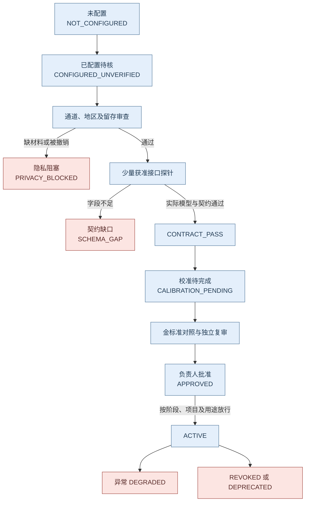
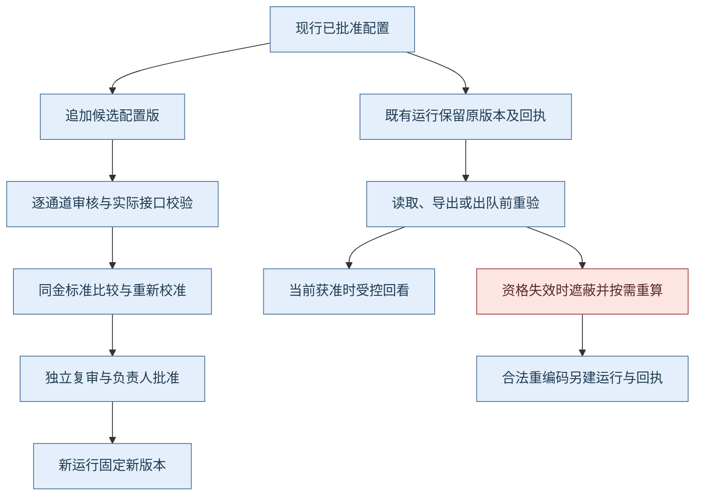

# 模型生命周期与校准

本协议属于 ROADMAP-V2 规划。Jev 继续按 `jev-1.14.0`、G-1、J-9、J-4、J-10、J-14 和 G4 验收。模型配置、能力与审查、校准、研究使用和发布分别留证。[适配器协议](ai-model-adapter-contract.md) · [原验收矩阵](../requirements-matrix.md)

## 配置到正式使用

蓝色节点为规划状态，红色表示该用途受阻。图中的状态是模型与通道的规划状态，项目正式统计还要求原研究准入和发布条件。

| 状态 | 触发及运行影响 |
|---|---|
| `NOT_CONFIGURED` / `CONFIGURED_UNVERIFIED` | 凭证未配置，或绑定后仍缺实际能力、审批或版本核验。诊断权限依实际数据和授权确定。 |
| `PRIVACY_BLOCKED` / `SCHEMA_GAP` | 审批缺失或失效，或返回字段无法满足指定用途。关闭相应通道或用途，保留脱敏原因。 |
| `CONTRACT_PASS` / `CALIBRATION_PENDING` | 实际接口契约有证据。需校准的正式用途等金标准和阈值完成。 |
| `APPROVED` / `ACTIVE` | 负责人已批准，且按实际项目、用途范围、来源资格及研究阶段启用。不同范围可分别判定。 |
| `DEGRADED` / `REVOKED` / `DEPRECATED` | 运行异常、授权撤销或版本停用。暂停受影响的新任务；现有回执及权限按当前依赖重验。 |

连接成功、接口成功、正式可用各有证据。正常传输仍须核项目权限、逐源许可、供应商及中转渠道、固定模型、实际契约、用途校准和正式准入。任何新增模型需验证其真实合同、评估记录及 M02 账户绑定。正式编码继续以原 Jev 门禁判定。

## 版本升级与受控历史

每次运行锁定 `model_profile_version`、`actual_model_id`、`adapter_version`、`question_set_version`、`registry_version`、`index_version`、`calibration_version` 和 `receipt_version`。同时保存实际证据、依赖、授权、当前资格与用途。重大版本变更或注册表升版时按原矩阵复核金标准。候选版本按用途分别跑合规真实探针、金标准评估、重新校准、独立复审和负责人审批。不同模型的未校准置信度分别记录，各自阈值须验证。

新配置只对获准的新运行生效。历史编码、原始回执、冻结身份、历史统计口径及报告版本保留，可见性按当前资格、到期和权限复核。历史重编码另建运行和回执，关联原版及原因。使用相同精确身份、题组和实际依赖做回查。不同模型、版本或尝试的分片分别归档，禁止合并为同一次正式编码。重新授权后先复验或重编，按发布规则重新审核。[统计回放与撤销](m06-statistics-contract.md)

## 运行模式

| 模式 | 用途与结果 | 规划归属 |
|---|---|---|
| MODE-1 单模型 | 以一个已批准、已验证和校准的固定模型编码，运行绑定全部版本 | P0，Jev 首发 |
| MODE-2 双模型对照 | 两个获准模型各跑同一可用样本，独立保存结果、耗时、用量和评估。默认在评估域 | 可选专项 |
| MODE-3 主辅复核 | 低置信、争议或人工指定样本投递给已批准的辅助模型。保留主辅结果、输入和最终人工决定 | 可选专项，模型一致不能充当人工金标准 |
| MODE-4 审批备用 | 经批准的故障策略创建一项独立运行，绑定备用模型本身的审查、接口证据及校准。展示该次实际模型 | 可选专项，正式同次运行禁止静默切换 |

金标准不写进客户载荷中的权限字段。人工标注规范、分歧依据、同语言阈值、评估集和校准版本按[评估协议](model-evaluation-protocol.md)管理。
