# ROADMAP-V2 完整开发路线图

2026-11-25 负责人批准本规划。开发分支 `codex/p0-0-connectivity`，规划基线 `3bd705befb98ee108b77603763c5571ceb7fdc44`。草稿 PR #1 与该基线一致，Ubuntu、Windows Server 2022、Chromium 作业均通过。[负责人批准](../decisions/roadmap-v2-owner-approval.md) · [M06-R 基线 CI](https://github.com/kurikiwoods-coder/voc-research-workbench/actions/runs/45585265229) · [草稿 PR #1](https://github.com/kurikiwoods-coder/voc-research-workbench/pull/1)

| 状态 | 基线观察 |
|---|---|
| 工程验收 | M01–M06 为 `ENGINEERING_PASS`，M06-R 为 `PASS`，M06 工程基线为 `FROZEN`，未关闭 P0/P1 为 0。 |
| 平台部署 | 原生 Windows 11 实机及部署门禁 PASS，证据归属于源码 `9c27231376fcc32aae39a9b63df6fa9b9b98c4c6`。Python 277/277、Node 2/2、Chromium 11/11 组。 |
| 正式业务 | 当前 P0-0，`G-1 = BLOCKED`。C0-3、C0-5、C0-6 有既有通过证据。C0-1、C0-2、C0-4 和通道审核待正式复验。 |
| 后续授权 | M07-A 至 D 已单独授权隔离工程。G-1-R-A/B 延期待另行授权。M08–M15 为 `NOT_STARTED`。 |
| 十万级查询 | 100K 合成规模热读样本 P95 为 39.073 秒，探索目标 15 秒。资格核验和投影是主要耗时，移交 M13-A。M06-R 复审已关闭。 |

[M06-R 审计](../audits/m06-final-engineering-audit.md) · [实机与回归](../evidence/m06-r/README.md) · [1K/10K/100K 对照](../evidence/m06-r/performance-comparison.md) · [最新开发状态](../../DEVELOPMENT_STATUS.md)

PDT v1.3.1 Word 正文与本机副本的 SHA-256 一致。ROADMAP-V2 已核对本机 27 页专案 v2.2 PDF，指纹与需求矩阵原登记一致。仓库提供摘要，历史审计中的原件缺失记录对应各自取证时点。版本分歧按原矩阵处理，包括 C0 编号、问卷分期、新意图及缺概率。五项负责人政策、六层架构、三层关系和统计口径 `M06-B-F.1` 继续作为接口依据。[PDT 正文](../pdt/PDT-v1.3.1.docx) · [PDT 导读](../pdt/PDT-v1.3.1.md) · [专案摘要](../proposal/voc-workbench-proposal-2026-11-23.md) · [需求验收矩阵](../requirements-matrix.md) · [冻结政策](../architecture/m06-owner-approval.md)

## 单元计数与分期

| 归属 | 功能和设计单元 | 专项复审和验收 | 合计 | 现有工程或复审完成 | 待推进 |
|---|---:|---:|---:|---:|---:|
| 基础及设计 M01–M06 | 30 | 1 | 31 | 31 | 0 |
| P0-0 正式准入复验 | 0 | 1 | 1 | 0 | 1 |
| P0 核心研究闭环 | 32 | 1 | 33 | 0 | 33 |
| P1 持续研究 | 6 | 1 | 7 | 0 | 7 |
| P2 雷达与监控 | 6 | 1 | 7 | 0 | 7 |
| 核心合计 | 74 | 5 | 79 | 31 | 48 |

| 模块 | 单元数 | 模块 | 单元数 | 模块 | 单元数 |
|---|---:|---|---:|---|---:|
| M01 | 4 | M06 | 8 | M11 | 4 |
| M02 | 4 | M07 | 4 | M12 | 6 |
| M03 | 4 | M08 | 5 | M13 | 5 |
| M04 | 5 | M09 | 4 | M14 | 5 |
| M05 | 5 | M10 | 5 | M15 | 6 |

M01–M05 的字母子编号为对既有成果的回顾性拆分，证据按原模块归档。本表的 31 项由 30 个基础设计和功能单元及已完成的 M06-R 组成。计划、实际代码、工程验收及正式验收分别使用各自证据。按照功能与依赖合并会话，数量用于管理范围和里程碑。产品化另列 15 项，长期规划合计 94 项。[可选产品化](productization-roadmap.md)

## 阶段与模块逻辑树

图中绿色为已完成的工程或复审，灰色为未开始，红色为正式准入阻塞。蓝色为规划扩展，紫色为可选功能。本基线暂无正在实施的业务单元。模型与产品化见[接口图](../architecture/ai-model-adapter-contract.md#接口树)及[产品化图](productization-roadmap.md#产品化路线)。

```mermaid
flowchart TD
    VOC["VOC 核心路线图"] --> P00["P0-0 连通性与底座"]
    VOC --> P0["P0 核心闭环"]
    VOC --> P1["P1 持续研究"]
    VOC --> P2["P2 雷达与监控"]
    P00 --> Base["M01–M06 基础工程和设计"]
    P00 --> Review["M06-R 工程复审"]
    P00 --> Gate["G-1-R 待授权<br/>正式 G-1 阻塞"]
    P0 --> Register["M07 注册表 · M08-A 至 D 采集"]
    P0 --> Discovery["M09 和 M10 双轨发现 · M11 审核"]
    P0 --> Apply["M12-A 至 E 决策编码"]
    P0 --> Output["M13-A 至 C 洞察 · M14-A 至 C 问卷"]
    P0 --> P0R["P0-R 核心验收"]
    P1 --> Expand["M08-E 来源 · M12-F 滚动校准"]
    P1 --> Trend["M13-D 至 E 分析与趋势"]
    P1 --> Feedback["M14-D 至 E 正式回收与回写"]
    P1 --> P1R["P1-R 运营验收"]
    P2 --> Radar["M15-A 至 F 竞品与持续监控"]
    P2 --> P2R["P2-R 最终复审"]
    classDef done fill:#DDF3E4,stroke:#35704C,color:#173B24
    classDef pending fill:#F1F3F5,stroke:#637180,color:#28323D
    classDef blocked fill:#FCE5E2,stroke:#A24943,color:#592B29
    class Base,Review done
    class Gate blocked
    class P0,P1,P2,Register,Discovery,Apply,Output,P0R,Expand,Trend,Feedback,P1R,Radar,P2R pending
```

## 基础工程与设计单元

M01–M06 共 30 项。表中证据是原模块和原阶段已有的验收记录。[工程审计索引](../audits/m06-final-engineering-audit.md) · [主模块档案](../../MODULE_ROADMAP.md)

| 单元 | 前置 | 职责及交付 | 核对依据 |
|---|---|---|---|
| M01-A | 仓库 | Python、Node、本机环境和六层项目结构 | G0、README、本机启动 |
| M01-B | M01-A | SQLite 基础存储、迁移、运行批次和诊断分域 | C0-4 工程部分、旧库回读 |
| M01-C | M01-B | FastAPI 回环服务、Windows 启动器和健康检查 | G0、三次空库冷启动 |
| M01-D | M01-B/C | CI、故障恢复、批次幂等与连通性检查 | C0-1～C0-6 对照、G7、BATCH-RECOVERY。正式复验见 G-1-R |
| M02-A | M01-C | 服务商配置、向导、项目运行可见状态 | API 配置回归 |
| M02-B | M02-A | 服务端凭证、DPAPI 持久化、轮换和删除 | TC-08、普通 Windows 用户 DPAPI |
| M02-C | M01-B、M02-B | 连接诊断、账户与通道审查状态、证据分域 | C0-1/2/5、D3 |
| M02-D | M02-C | Jev Token Center、用量记录、同步状态及额度账本基础 | TC-01～TC-08、C0-4 工程部分 |
| M03-A | M01-B/C | 项目生命周期与工作区切换 | BIZ-SCOPE、项目 CRUD |
| M03-B | M03-A | 单产品、跨品类及非产品等研究范围 | BIZ-SCOPE、D1、项目范围用例 |
| M03-C | M03-B | 冻结范围、不可变版本及历史定位 | CAT-6/7 工程前提、原批次冻结引用 |
| M03-D | M03-A/C | 归档、恢复、跨项目隔离 | 归档状态和越权引用回归 |
| M04-A | M03-C | CSV、XLSX、多编码及工作表解析 | INGEST、边界和恶意文件回归 |
| M04-B | M04-A | 字段映射与本地数据预览 | INGEST、映射往返 |
| M04-C | M04-B | 行级质量、重复候选和治理提示 | RAW、许可和缺字段边界 |
| M04-D | M04-C | 批次持久化、幂等确认、回滚和撤销 | BATCH-RECOVERY、G7 |
| M04-E | M04-D | 错误报告、来源行和冻结版本追溯 | G2 工程前提、CSV 安全 |
| M05-A | M04-D/E | 不可变原话和核验快照 | RAW、重启回查 |
| M05-B | M05-A | 文本重复组、当前有效成员及主记录 | RAW、同文与独立来源边界 |
| M05-C | M05-A、M03-C | 来源、原话、发布时间、采集方式及保留溯源 | G2 工程前提、精确来源定位 |
| M05-D | M05-A/C | 许可、隐私、保留和数据角色治理 | SOURCE-POLICY、RAW-ROLES、PRIVACY |
| M05-E | M05-B/D | 人工审核、撤销、单条重新授权及实时资格 | M05-R/M05-R2、Pre-M06 独立反例 |
| M06-A | M03、M05、PDT | 三层关系、稳定身份、接口与计数设计 | CAT-1～CAT-10 设计映射 |
| M06-B | M06-A | 独立架构复审、反例与规模原型 | 台账和反例证据 |
| M06-B-F | M06-B | 负责人裁定五项政策和冻结设计 | 负责人批准、M06-B-F.1 |
| M06-C1 | M06-B-F | SQLite v7 约束、迁移、封版与恢复 | C1 约束和旧库迁移证据 |
| M06-C2 | M06-C1、M05-E | 实时资格、同连接写事务、撤销和 UTC 边界 | C2 WAL 并发和接口兼容证据 |
| M06-C3 | M06-C1/C2 | Mention、Evidence、Unicode 半开区间和逐边产品确认 | C3 独立反例、CAT-6/8 工程前提 |
| M06-C4 | M06-C3 | 三层双向查询、精确授权和组合事务 | CAT-1/2/5/7/8/9 工程前提 |
| M06-C5 | M06-C2/C4 | 六桶、统一分母、排除账、对账和规模恢复 | CAT-3/6/8/10 工程前提、两条恒等式 |

另有真实历史复审 M05-R、M05-R2、Pre-M06 及 C1–C5 分阶段取证，按各自原记录追溯。[M05 许可复修](../evidence/m05/permissions-review.md) · [Pre-M06 审计](../audits/pre-m06-audit.md) · [C1–C5 实施](../architecture/m06-implementation-plan.md) · [C5 结项](../evidence/m06-c5/README.md)

## P0 核心研究闭环

正式工作受 G-1 约束。获准的 M07-A 至 D 使用隔离数据，阶段状态见 [M07 工程验收](../evidence/m07/README.md)。M08–M15 待启动。注册表联合发行需要 M07 的版本契约和 M11 的可信人审共同验收。

| 单元 | 前置 | 职责及交付 | 验收重点 |
|---|---|---|---|
| M07-A | M06-C3/C4 | 注册表数据契约、稳定 Intent/Task ID、M06 消费接口 | CAT-1/2/5/7，精确版本和共享投影 |
| M07-B | M07-A | 意图定义、例句、生命周期、主次任务归属 | CAT-1/5，已确认恰一有效主类，缺主候选留待审 |
| M07-C | M07-B | 不可变版本、差异、合并及拆分谱系、独立问卷验证状态 | CAT-2/9，历史可回看，项目私有证据按当前授权投影 |
| M07-D | M07-C、M11 联调 | 注册表 UI、检索、版本对比和联审接口 | CAT-2/8/9，双向一致、获准后可回查，正式发行与 M11 同验 |
| M08-A | M03-C、M05-E | 来源适配协议、权限、采样和留存策略 | SOURCE-POLICY、PRIVACY，授权与访问限制逐源记录 |
| M08-B | M08-A、M02 | Tavily 与 Brave 双搜索、URL 发现与许可页面回源 | INGEST、C0-3，区分发现链接、可访问页和真实原话 |
| M08-C | M08-A/B | 获准论坛、YouTube 适配范围、许可正文通路及备用 Reddit | 依原 INGEST、PDT §4 及 §13.1，至少一条获准论坛、YouTube 或许可页面能回源 |
| M08-D | M08-B/C、M04/M05 | 采样任务、批次、额度、暂停、重试、跨站去重和 CSV 兜底 | G1/G2/G7、RAW，三批至少 100 条真实语义片段及 30/30 回源抽查 |
| M09-A | M05-E、M06-C3 | 本地文本预处理、Embedding Adapter 与匿名输入 | DISCOVERY、PRIVACY，向量版本和当前片段资格 |
| M09-B | M09-A | BERTopic 聚类、主题提取和参数记录 | 可回放模型、预处理和参数 |
| M09-C | M09-B | 主题运行版本、成员、证据、离线复跑与差异 | G3，主题能下钻到合格原话 |
| M09-D | M09-C | 聚类视图、候选输出与已知/未知盲测 | DISCOVERY、G3，候选进入人审 |
| M10-A | M06-C3、M09-A、已批准通道 | TopicGPT 四步编排与最小 LLM Adapter | MODEL-ADAPTER-01、DISCOVERY、PRIVACY |
| M10-B | M10-A | 主题生成、精炼、分配、修正及每步留痕 | DISCOVERY，同范围复跑及证据核验 |
| M10-C | M10-B、M07-A | 未知、低相似和残差候选及证据 | G3、J-10，保留已确认定义与待审输入 |
| M10-D | M09-D、M10-C | BERTopic 与 TopicGPT 同样本、同版本对照 | DISCOVERY，单轨覆盖与双轨差异可复查 |
| M10-E | M10-D、M11 联调 | 发现实验室、带证据盲测和人审入口 | G3、CAT-4，允许真实批次无新意图或大类 |
| M11-A | M06-C4、M07-A、M09/M10 候选 | 候选、未知与低置信队列，后接 M12 | CAT-4/5、J-5/10，输入版本和项目授权明确 |
| M11-B | M11-A | 确认、驳回、合并、拆分及人工理由 | CAT-4/5，保留原模型结果和审计历史 |
| M11-C | M07-C、M11-B、M06-C4 | 候选意图与任务大类联合审核、组合事务和版本发行 | CAT-9，现行资格、原子性、版本竞争和幂等重放 |
| M11-D | M11-C、M12 联调 | 审核 UI、查询历史、编码复核接入 | J-5/6、PRIVACY，低置信必经队列 |
| M12-A | M02、M06/M07 | 通用 Decision Adapter、版本配置和能力协议，Jev 首个正式适配，隔离合成适配用于工程测试 | MODEL-ADAPTER-01、MODEL-CAPABILITY-01、MODEL-VERSION-01，冻结原 Jev 行为 |
| M12-B | M12-A、G-1、获准语料 | 固定 `jev-1.14.0` 的 Choice、Score、Noul 与完整概率落库 | J-1/4/9/12/13，缺字段记 `schema_gap` |
| M12-C | M07-C、M09-A、M12-A/B | 全局意图 Top-K、None 与独立 Noul、未知和复核分流 | J-5/10/14，最多 19 个已知意图加 None，盲测 Recall@K ≥95% 才放量 |
| M12-D | M11、M12-B/C、人工金标准 | 100–200 条金标准、中文子集、概率校准和阈值版 | J-2/3、G4、D2，报告分类 F1、分档一致和问题 F1 |
| M12-E | M02-D、M12-A/B | 11 题 8+3、Token 预算、跨分片回执、账本、幂等恢复与故障处理 | J-6/7/8/11、G5/G7、TC-01～TC-08，实际用量、同步状态与输入可回查 |
| M13-A | M06-C5、M08-D、M12 接续 | 统一指标、版本绑定和分母消费，承接十万级性能债务 | CAT-3/10，按同一证据交集、唯一发生与两条恒等式验算 |
| M13-B | M13-A、M12 | 基础需求分布、问题分析、基础情感和样本漏斗 | BASIC-DASH、UI-STATES，区分来源和分母 |
| M13-C | M13-B、M11、M12 | 原话下钻、报告、发布前与历史读取复核 | UI-EVIDENCE、RESEARCH-REPORT，许可变化按冻结口径重算 |
| M14-A | M11、M13 已确认发现 | 发现到问卷题项映射、ODI 排序及获准 AI 草稿 | SURVEY，五类映射、每题一项证据、1–2 道开放题 |
| M14-B | M14-A | 在线编辑、人工批准、回链和匿名保护 | SURVEY、PRIVACY，样本与招募口径留痕 |
| M14-C | M14-B | 导出、Forms 授权准备和 2–3 人真人试填 | SURVEY、D4，草稿、试填与审批证据可复查 |

M08-C 的 P0 正文通路沿用原 INGEST 与 §13.1。M08-E 在 P1 做第二论坛、YouTube 专项扩展及期刊背景对照。M09/M10 支持本机开放编码和人工复核，内外部处理各自受数据角色与通道审批约束。M12 保留原 Jev 全部验收要求，P0 正式编码采用单模型模式。M13 复用 `GET /api/studies/{study_id}/denominators`，区别缺项 `null` 和核准空集 `0`，剔除账单列。P1 完成完整 G6 的正式回收及回流。[M06 消费契约](../architecture/m06-consumer-handover.md) · [模型接口](../architecture/ai-model-adapter-contract.md) · [冻结统计契约](../architecture/m06-statistics-contract.md)

M13-A 接手 100K 查询技术债。先以同一证据过滤条件复测常见窄范围及全范围查询。若要引入后台计算或增量方案，先核准快照、撤销及授权失效机制，出结果时重验当前资格，比较响应和对账等价。15 秒保持探索目标。[规模复测](../evidence/m06-r/performance-comparison.md#剩余瓶颈)

## P1 持续研究

| 单元 | 前置 | 职责及交付 | 验收重点 |
|---|---|---|---|
| M08-E | M08-D、P0-R | 第二论坛、YouTube 评论及期刊背景扩展 | P1-SOURCES，文献与用户原话分角色和分母 |
| M12-F | M12-D/E、M11、P0-R | 滚动金标准、随注册表升版复核和重新校准 | P1-GOLD，每批抽查 20 条，覆盖高低置信及人审积压 |
| M13-D | M13-C、P0-R | 高级情感、问题严重度和研究建议，七维下钻 | P1-ANALYSIS，满意/挫败/信任、建议四要素，n<10 隐去均值和比例 |
| M13-E | M08、M13-D、P0-R | 同来源、查询和采样口径的周基线、异常复跑及历史对照 | P1-TREND，至少四周真实采样，保留实际发布日期 |
| M14-D | M14-C、P0-R | Google Forms 正式发布、授权有效性及真实回收 | G6、PRIVACY，真实答卷的招募、样本和授权可核 |
| M14-E | M14-D、M07-C | 答卷分析及验证状态回写 | P1-REFLOW、G6，阈值预设，验证状态独立且证据回链 |

第二套决策模型可在 P1 或后续专项按授权接入，属于模型扩展计划。

## P2 竞品 Radar 与持续监控

| 单元 | 前置 | 职责及交付 | 验收重点 |
|---|---|---|---|
| M15-A | P1-R、M03、M13 | 自有与竞品项目分域，统一对照口径 | P2-RADAR，对照证据、采样偏差及独立分母 |
| M15-B | M15-A、M08 | 自有合规导出、公开人工采样、合规聚合数、Shulex 授权批次 | P2-AMAZON，来源批次审计；聚合证据与可核验体验原话分开，US verified、型号和原有来源规则 |
| M15-C | M15-A、M08 | GitHub Issues/Discussions 信号及来源留痕 | P2-GITHUB，季度三角验证，技术信号独立于主需求统计 |
| M15-D | M15-A/B/C、M13 | Radar 对比、痛点热力图、机会及风险建议 | P2-RADAR，同口径客观对照，结论可回链 |
| M15-E | M15-A、M08-D | 授权来源定期任务、暂停恢复、失败重试和日志 | P2-SCHEDULE，重复触发幂等，来源撤销后停止采集 |
| M15-F | M15-D/E、M13-C | 跨品类研究报告、独立历史版本及趋势对照 | P2-HISTORY，历史重验授权、同口径并集按发生去重 |

## 五个复审及验收节点

| 节点 | 阶段及前置 | 交付物与出场条件 | 当前状态 |
|---|---|---|---|
| M06-R | 基础及设计，M01–M06-C5 | 跨模块审计、修复、回归、规模恢复、实机部署与冻结记录 | PASS |
| G-1-R | P0-0，M06-R 已完成且负责人另行授权 | 同一正式批次的 C0-1～C0-6 和所选供应商及通道审核，脱敏请求、响应与账本证据供 G-1 核对，固定版本供 J-9 接续 | 待授权，G-1 BLOCKED |
| P0-R | P0，G-1 与 M01–M14 的 P0 交付 | G0–G5、G7、CAT-1～CAT-10、J-1～J-14 及原矩阵的正式验收，含 P0 问卷试填。M12 独立专项复审归 M12 模块 | NOT_STARTED |
| P1-R | P1，P0-R 与六个 P1 单元 | P1-ANALYSIS/TREND/SOURCES/GOLD/REFLOW、完整 G6，真实趋势和实际答卷回写 | NOT_STARTED |
| P2-R | P2，P1-R 与 M15 六单元 | P2-RADAR/AMAZON/GITHUB/SCHEDULE/HISTORY，全平台工程复审及正式业务记录 | NOT_STARTED |

G-1-R 逐项复验实际 `jev-1.14.0`、8+3 分片、三类真实响应、合规发现与原话、SQLite 回读和实际用量、内部 CX 隔离演练、三层召回及通道隐私、留存、地区、分处理商。已有 C0-3、C0-5、C0-6 各自证据按原矩阵核对其可用范围。同一正式批次仍需满足六项和审批要求。[验证执行入口](development-sequence.md#下一授权入口) · [G-1 验收矩阵](../requirements-matrix.md#当前验收快照)
