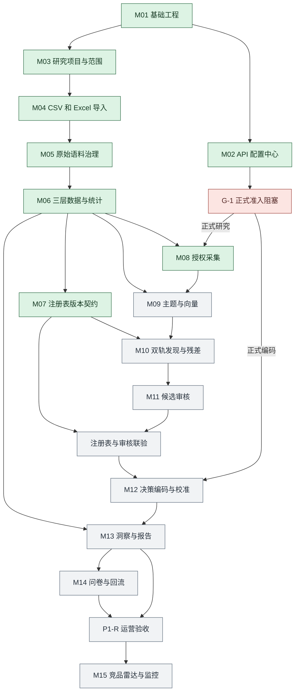
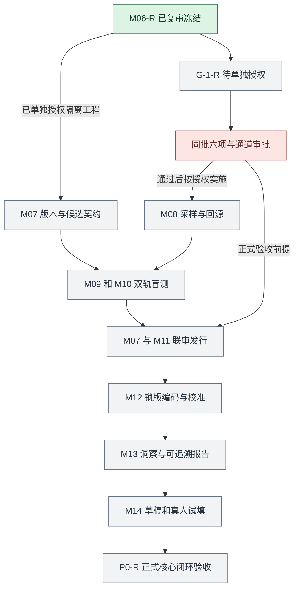
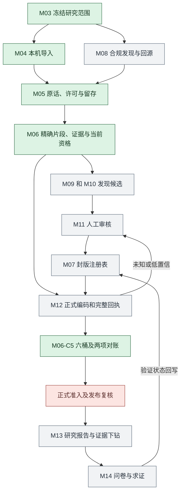

# 开发顺序、关键路径与版本目标

冻结基线为 `3bd705befb98ee108b77603763c5571ceb7fdc44`。M01–M06 工程验收通过，M06-R 复审通过并冻结。G-1 保持 BLOCKED。M07 及 M08 P0 A–D 的隔离工程验收通过，P1 的 M08-E 及 M09–M15 待启动。G-1-R-A 已实现，PackyCode 合成契约通过，正式 G-1-R-B 待补供应商审核和同批验收。箭头表示依赖。联合验收另列为里程碑。[工作单元](ROADMAP-V2.md) · [M07 工程证据](../evidence/m07/README.md) · [M08 工程证据](../evidence/m08-cd/README.md) · [G-1-R-A 接续](../packycode.md) · [基线审计](../audits/m06-final-engineering-audit.md)

## M01–M15 模块依赖图

M07 先交稳定 ID、版本结构、候选态、共享定义及查询契约。M11 先接候选和审核能力，两者联验才完成候选意图与任务大类发行。M12 使用实际可用的确切注册表版本，低置信与未知回到已经接好的审核或发现入口，属于运行时反馈。离线工程夹具可为 M09/M10 与 M11 提供接口样本，正式闭环仍使用矩阵规定的证据与准入。[M06 消费契约](../architecture/m06-consumer-handover.md) · [组合事务](../architecture/m06-data-model.md#原子提交与并发)

## M06-R 至 P0-R 关键路径

## 原话到研究报告的数据流

实线显示主要的数据与输出关系。绿色表示现有工程接口，灰色表示正式功能待实现，红色表示正式发布受阻。M11 和 M12 的反馈用于复核、发现和随后重新编码。

指标发布先核项目、当前授权及实际证据和上下文资格。M13 根据同一证据交集按唯一发生汇总，核对六桶与主类。研究报告标明样本来源、真实日期、分母、偏差与版本。撤销后重新计算，历史报告、下载或出队均重验当前权限和许可。[统计与发布边界](../architecture/m06-statistics-contract.md)

## 下一授权入口

G-1-R 需负责人单独授权。拿到授权后，先核对实际所选提供商及调用通道的留存政策、地区、分处理商、公开语料处理范围和组织审核。TypeSafe 的 ZDR 以实际组织证据为准，JevModel 及中转通道分别审查。检查既有脱敏回执能否按原规则纳入同一验收批次，并按最小必要调用量执行所缺步骤。若所选通道存在 Score 等字段缺口，保留 schema_gap，按原流程独立审查可能合格的其他 Jev 通道。齐全后记录同批次 C0-1～C0-6、后端回读、余额同步或未同步状态及审查凭据。任何缺项保留 BLOCKED，正式 P0 仍等 G-1。工作台已有连通性中心、恢复入口及专用凭证界面。[连通性操作](../connectivity.md) · [G-1 矩阵](../requirements-matrix.md#当前验收快照) · [既有 Tavily 回执](../evidence/p0-0/tavily-live/README.md)

## 会话安排与出场记录

| 阶段 | 可合并的工作 | 适用联验 |
|---|---|---|
| M07 | A–D 可在同一会话交付契约、治理和 UI | 版本差异和权限回归。正式联合发布待 M11 与 M07 联验 |
| M08 | A/B 基础及双搜索，C/D 来源和任务。E 按 P1 扩展 | 双源故障切换、CSV 全流程及真实采样与回源 |
| M09 | A–D 合并为完整离线主题试点 | 向量/索引版本、聚类复跑及盲测 |
| M10 | A–C 生成流程和残差，D/E 双轨及审核交接 | 同样本比较、无新意图和新类盲测 |
| M11 | A–D 合并候选、组合事务和审核 UI | 与 M07 联合发行，与 M12 连通复核入口 |
| M12 | A 接口与兼容层，B/C 真实编码和召回，D/E 校准、分片及账本按风险分批 | 单独复审版本、概率、幂等和校准。F 延续到 P1 |
| M13 | A–C 基础洞察和报告，D/E 高级视图和四周基线 | 两条对账、真实数据及历史读取。100K 技术债在 A 登记 |
| M14 | A–C 草稿与试填，D 发布回收，E 分析回写 | P0 实操与完整 G6 分阶段验收 |
| M15 | A–C 竞品与来源，D Radar，E/F 调度与历史报告 | P2-R 跨模块回归与正式验收 |

每个主模块交接记录实际基线 SHA、职责、消费接口、冻结约束、已通过测试、剩余验收、缺陷和下一授权范围。一个会话可以交付连续子单元，每个里程碑仍需可独立检查。已有历史以证据索引接续，保留适用的独立复审、隐私核对及测试。

## 版本边界与计划日期

| 版本 | 可使用范围 | 出场口径 |
|---|---|---|
| `ENGINEERING_TEST_VERSION` | 隔离合成夹具走完整工程流程 | 自动化、故障、权限和对账结果。正式分母按冻结契约显示不可用 |
| `PERSONAL_RESEARCH_VERSION` | 个人试用范围内已批准、已实测的来源、模型和功能 | 逐源许可、供应商审查、正式准入照常核验。等待审查的功能保持不可用或测试状态 |
| `FORMAL_RESEARCH_VERSION` | 已通过相应阶段验收的研究、分析及发布功能 | 真实业务证据、金标准、同批准入与发布审批。P1 保留四周真实趋势及问卷回流 |

| 计划日期 | 目标 | 调整条件 |
|---|---|---|
| 2026-12-06 | P0 核心工程版 | 取决于模块授权、接口可用性、回归及实际阻塞 |
| 2026-12-10 | 个人研究试用版，尽可能完成获准范围内的 P1/P2 基础工程能力 | 逐源许可及 G-1 决定可开放功能。征样、四周观测、正式答卷回收和重大缺陷按实调整 |

日期是计划目标。正式阶段的开始、样本量、观察窗口和验收期限以原矩阵与实际证据核定。高级模型模式及 P2 后产品化按各自授权启动。[原需求验收矩阵](../requirements-matrix.md) · [产品化规划](productization-roadmap.md)
