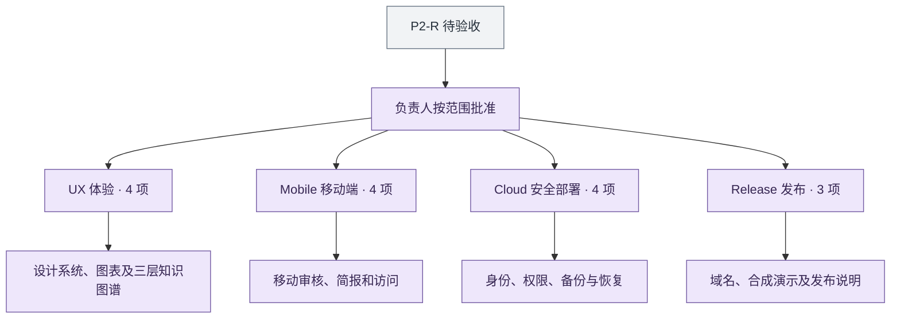

# P2 后可选产品化路线

产品化在 P2 核心功能稳定后由负责人分别授权。UX、Mobile、Cloud 和 Release 共 15 个可选工作单元，与核心 79 项合计 94 项规划单元。高级模型评估、主辅复核与更多模型的安排单独授权定范围。四个方向均处于可选规划。

## 产品化路线

| 单元 | 前置 | 可选交付 | 验收 |
|---|---|---|---|
| UX-A | P2-R、授权 | 设计系统、导航、深浅色主题 | 组件、键盘访问及可读状态一致 |
| UX-B | UX-A、M13 | 高级仪表盘、交互图表和研究操作区 | 指标仍用同一分母，筛选、失败及溯源实测 |
| UX-C | UX-A、M06/M07 | 产品、意图与任务三层交互图谱 | 当前授权、精确证据和同版双向关系 |
| UX-D | UX-A/B/C | 全平台交互和视觉复验 | 关键任务在桌面及窄屏完成 |
| MOB-A | P2-R、授权、UX-A 接口 | 手机及平板响应式布局 | 不同视口、键盘和触控可用 |
| MOB-B | MOB-A | PWA 和移动导航 | 更新、缓存和失效方案经审查，敏感数据不入客户端持久缓存 |
| MOB-C | MOB-A/B、M11/M13 | 移动候选审核、研究简报及任务状态 | 按身份验证操作权限，复用审批和撤销规则 |
| MOB-D | MOB-C、CLD-C/D | 获准跨设备安全访问及移动端验收 | 验证设备撤权、会话、历史证据投影与失效 |
| CLD-A | P2-R、单独安全审批 | 可信身份、登录、会话与设备 | 项目隔离、最小权限和撤销可实测 |
| CLD-B | CLD-A、获授权的部署设计 | 云部署和数据库适配 | 项目隔离、迁移与计数可复现 |
| CLD-C | CLD-A/B | HTTPS、权限、备份和安全审计 | 权限、留存、日志脱敏、恢复与删除按实际边界核验 |
| CLD-D | CLD-C | 跨设备同步、恢复及部署验收 | 版本冲突、撤销、恢复与回滚验证 |
| REL-A | P2-R、授权、获审发布入口 | 域名、产品官网与访问入口 | 发布目标、访问范围及身份入口核准 |
| REL-B | REL-A、合成隔离验证 | 公开演示 | 独立合成数据、与研究库和凭证物理或逻辑隔离 |
| REL-C | REL-A/B | 安装、操作文档及版本发布 | 安装可复现，版本和已批准能力可查 |

现行本机服务只监听回环地址。任何公网部署须有新安全架构和负责人授权。真实内部 CX、公司非公开资料和问卷原始答卷继续留在授权本机。跨设备范围、可同步字段及数据所在地在部署前审定。[项目规范](../../AGENTS.md) · [模型安全边界](../architecture/ai-model-adapter-contract.md#数据安全及模型配置中心) · [核心路线图](ROADMAP-V2.md)
